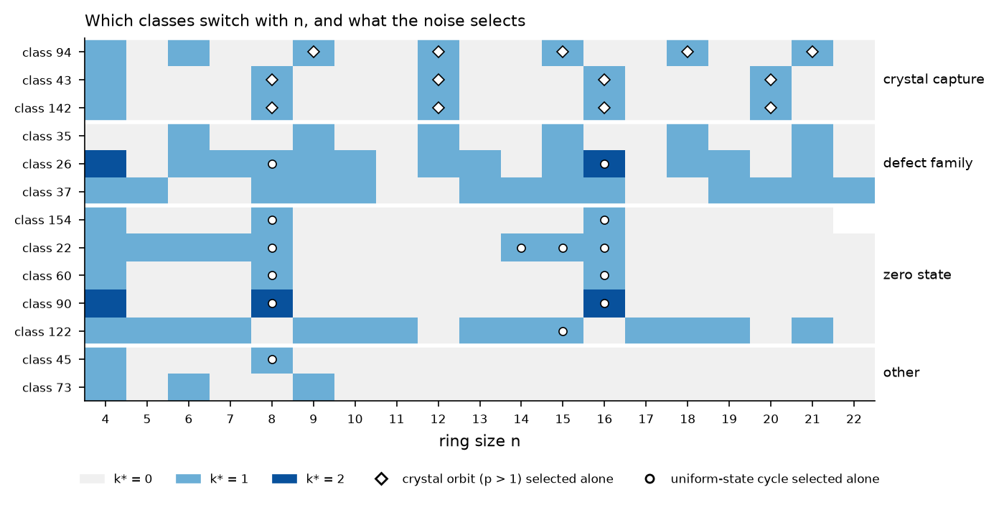
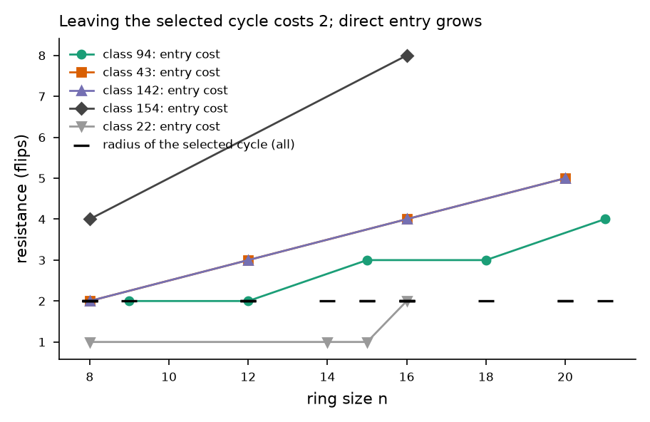

# Why the small-noise classification of elementary cellular automata depends on the ring size

Ring-size study on top of version 0.2 of *Rule identifiability in elementary cellular automata under
dynamical noise* (version DOI 10.5281/zenodo.24093547). Branch `ring-size-mechanisms`. Generated by
`code/ring_size/make_report.py` from `code/ring_size/report_template.md` and the data in
`data/ring_size/`. The tables and the generated sentences (lists and ranges of ring sizes, counts, the
statements on classes 45 and 73, the seed-orbit sets, the cost line) are filled in from data files; the
remaining prose is written by hand. Values that this study did not compute itself are taken from the
outputs of the independent verification and carry the name of their file.

This version applies the findings of the independent verification of 14 November 2026
(`VERIFICATION_ring_size.md`; its header lists how each finding was handled) and takes in the results that
the verification proved (Section 5.7).

Every claim carries one tag:
**[proved]** a proof is given here (computer-assisted proofs say which finite computation they rest on);
**[proved, verification]** proved by the independent verification session, not by this study; the proof is
in the file named, its idea is given here, and who checked it is stated in Section 5.7;
**[computed]** an exact computation for the ring sizes stated, nothing beyond them;
**[observed]** a pattern in computed data, or a sampled test, without exactness for the statement as a whole.

## Summary

The ring size enters through one object, the one-flip graph G1 between the cycles of the map. Two general
statements organise the analysis: the noise-selected cycles are a union of closed classes of G1
(Theorem A), and a cycle that cannot be left with one flip is selected alone as soon as every other cycle
reaches it by one-flip steps, however large the direct entry cost (Lemma B). Both are restatements, for
this model, of results known in the stochastic-stability literature (Section 4; primary texts not read)
and are not counted among the results of this study.

**Main results.**

1. *Mechanisms, computed for n <= 22.* In ten of the 13 switching classes the selected cycle at the
   switching sizes is a spatially periodic crystal that exists only when its period divides n (classes 94,
   43, 142, and class 35 within its code-carrying family), or the zero state, which cannot be left with one
   flip exactly when a single flip dies out on the ring (classes 154, 26, 22, 60, 90, 122). Classes 37, 45
   and 73 are not covered by these two mechanisms.
2. *Proved for all n [proved, verification].* For rule 154, k* = 1 iff n is a power of two, for every
   n >= 3. For class 94, k* = 1 at every n >= 6 divisible by 3. Both proofs are due to the independent
   verification session and were checked as described in Section 5.7.

Also proved for all n: k* = 0 for class 45 at odd n; the zero state of rule 26 cannot be left by one flip
iff n is a power of two (even n: Proposition R154; odd n: verification), and the same for rule 22 when
4 | n; the crystal of class 94 cannot be left by one flip for every n >= 6 divisible by 3.

**Not proved.** (i) That every cycle reaches the selected crystal or zero state by one-flip steps, for
classes 43, 142, 26 (n = 2^k), 22 and 122 (n = 2^k - 1): computed for n <= 22 and sampled up to
n = 32. (ii) The one-flip radius of the crystal of classes 43 and 142 beyond n = 400
(computed up to there). (iii) The set of n at which a single flip of the zero state dies, for rule 22 at n
not divisible by 4 and for rule 122 (seed orbits up to n = 256, some of them open). (iv) The direction
"the condition on n fails, hence k* = 0" for every class except 154 (all n) and 45 (odd n).
Class 122 at even n, class 26 away from powers of two, and the single switches of classes 45 and 73
resist; partial results of the verification on classes 122 and 26 are in Section 5.8.

## 1. Question

For n = 8..20, v0.2 found 13 of the 88 classes whose small-noise order k* changes side with the ring
size n (k* = 0 iff the noise-selected cycles, those of minimum stochastic potential, jointly contain all
eight neighbourhood codes). The question of this study: why does the classification depend on n, and
which of the observed patterns can be proved for every n? Not in scope: other noise models, unknown
eps, partial observation, changes to v0.2.

## 2. Literature

Full review with access status, what was read (version, pages) and BibTeX: `literature_ring_size.md`
(prepared in the study session by a separate literature track; nothing is marked as read that was not read).
Several hosts were refused by the sandbox even after access was approved (Wolfram Atlas, wolframscience.com,
projecteuclid.org, direct arxiv.org, ddlab.org); in the study session Martin–Odlyzko–Wolfram (1984), Jen
(1986, 1988), Wuensche–Lesser (1992) and Mairesse–Marcovici (2014) were not read. The independent
verification then read Martin–Odlyzko–Wolfram (1984) in full and the published version of Ellison (2000) in
part (15 of 29 pages: all definitions, Theorems 1 to 3, Section 6.2), and Jen (1986, 1988) as abstracts only;
Wuensche–Lesser (1992) and the Wolfram Atlas remained unobtainable
(`verify_ring_size/literature/literature_check.md`). Statements below that rest on the verification's
reading say so.

**Has the dependence of noise-selected attractors on the ring size been studied?** *Not found* in the
searched sources for ECA with i.i.d. bit-flip noise and minimum-stochastic-potential selection. Closest:

* Bagnoli, Baia and Matteuzzi (arXiv:2406.15408 v2, the extended version of the ACRI 2024 chapter; the
  chapter itself not read) treat all 88 classes under a single-flip "vanishing" noise, but only at L = 17
  (Table 2) and with a single-flip chain between attractors, not stochastic potentials; they do not vary L.
* Ellison (1993, Econometrica 61, Theorem 1(b), p. 1055): coordination on a circle; the parity of N changes
  the order of the non-selected state through a 2-cycle that exists only for even N; the selected state does
  not change with N.
* Bušić, Mairesse and Marcovici (2013, Adv. Appl. Probab. 45, §5.1, p. 977): a majority-flip PCA on Z/nZ
  puts its invariant measure on the two alternating configurations exactly when n is even. Fixed noise, not
  a small-noise limit; the closest published analogue of crystal capture found.
* Studies of asynchronous updating report ring-size conditions (n even, 3 | n, 4 | n) for convergence;
  different noise model, not read.

**Selection by one-mutation steps (Theorem A, Lemma B).** The structure used in Section 4 is known in the
stochastic-stability literature: Samuelson (1994) and Nöldeke and Samuelson (1993, Proposition 1) on
mutation-connected and locally stable components (primary texts not read; known here from the abstract of
Samuelson 1994, from secondary descriptions, and from Ellison), and Ellison (2000, Section 6.2, pp. 37-38),
who attributes to them the lemma that a set reachable from every other limit set by a chain of single
mutations is selected. Not found in the sources read: the explicit potentials gamma_min = m - 1 and
gamma_min = m + q - 2.

**Rule 154 under noise:** *not found*, apart from one row of Bagnoli et al.'s Table 2 at L = 17 (1688
attractors, S = S* = 1, no discussion). Powley and Stepney (2009, J. Cellular Automata 4:125–136, §5.2,
read) place 154 as the only nonlinear rule in the group of the linear rules by the even/odd alternation of
the automorphism count of its transition graph, and name the shared Sierpiński pattern from a single seed.
That rules 154 and 45 are reversible for odd N is in the literature: Bhattacharjee and Das
(arXiv:1903.06011, Example 2; read in part by the verification), Fedoriaka (arXiv:2501.06648; a computation
for N <= 20 with explicit constructions; read by the verification), and Nobe and Yura (2004; abstract and a
search snippet only). Lemma P below re-proves this known fact by a pair-graph certificate. No conjugacy or
factor map between 154 and rule 90, and no statement on 154 at n = 2^k on a ring, was found in the sources
read; partial precedents of the reduction to rule 90 are a comment in OEIS A070886 and Section 5 of
Martin–Odlyzko–Wolfram for rule 18 (see Proposition R154). In this study, every block map of width at most 4
that intertwines rule 154 with a radius-1 rule maps it onto rule 154 or 166, its own symmetry class;
no factor onto an additive rule exists at these widths [computed, `factor_search.csv`].

**Rule 90 at n = 2^k** (used in Proposition R154): Martin, Odlyzko and Wolfram (1984), Lemma 3.5 (p. 230):
for N = 2^j every configuration evolves to the null configuration; with their Theorems 3.3 and 3.4 and
corollaries the single-seed orbit dies iff N is a power of two (read by the verification). NKS p. 963 (read)
gives the fraction of states on cycles for rules 60 and 90 as 2^(−2^IntegerExponent[n,2]), which for n = 2^k
leaves only the null state; the nilpotency is also proved directly in v0.2 (Proposition 1) and here.

**The crystal of class 94.** The three phases of (011)^{n/3} are the non-null fixed points of rule 90 for
3 | N given by Martin, Odlyzko and Wolfram (1984), Lemma 3.7 (p. 234; read by the verification); rules 94
and 90 agree on the codes 3, 5, 6. Its one-flip radius under rule 94 was not found in the sources read.

**Radius and modified coradius.** Ellison (2000, Rev. Econ. Stud. 67:17–45, doi 10.1111/1467-937X.00119):
radius R(Ω), coradius, modified coradius CR*(Ω) (path cost minus the radii of the intermediate limit sets),
and Theorem 2 (Section 4.2, p. 30): if R(Ω) > CR*(Ω) for a union Ω of limit sets, then (a) the long-run
stochastically stable set is contained in Ω and (b) W(y, Ω, ε) = O(ε^(−CR*(Ω))) for every y outside Ω. The
study session read the January 1999 working paper, which has the same theorem numbers; the journal pages
were read by the verification.

## 3. Setting and notation

As in `note/note_v0.2.tex`: rule f, global map F on Z/nZ, resistance r(x, y) = H(Fx, y), cycles
C_1..C_m of F, V(C, C') the minimum path resistance from C to C', stochastic potential gamma(C) the
minimum weight of an in-tree on the cycles rooted at C, S the set of noise-selected cycles
(gamma = gamma_min). V(C, C') >= 1 for C != C' (a zero-resistance step from a cycle state stays on the
cycle). New notation:

* **one-flip graph** G1: the digraph on the cycles with an edge C -> C' iff V(C, C') = 1, i.e. one flip in
  some state of C followed by the deterministic orbit ends on C';
* **radius** r(C) = min over C' != C of V(C, C') (r(C) >= 2 iff no single flip leaves C);
* **closed class**: a strongly connected component of G1 that no edge of G1 leaves;
* **crystal**: a cycle whose states have spatial period p < n; it exists on Z/nZ only if p | n [proved: the spatial period divides n].

All computations use the v0.2 solver (`code/fw/`) for cycles, V and gamma, and
`code/ring_size/mech.py` for G1, radii, periods and the tests below. Before use, an independent
verifier (`code/ring_size/verify_mech.py`: own map, own cycles, Dijkstra on the full resistance graph
without the single-layer reduction, potentials by networkx arborescences) was compared field by field:
432 non-bijective (rule, n) pairs among the 466 pairs of all 88 classes at
n = 4..8 and the 13 switching classes at n = 9, 10 (the 34 bijective pairs are not treated by
the verifier), 0 disagreements after one convention fix (BUG-R1, a single cycle was called a
crystal orbit; regression test in `code/ring_size/test_ring_size.py`). The mechanism records for the 13
classes at n = 8..20 agree with `data/fw_sweep.csv` of v0.2 in the number of cycles, the number
of selected cycles, gamma_min, k_c and k* for all 169 (rule, n) pairs (0
disagreements; gamma_min is not compared on the 12 bijective pairs, where the value is m - 1 and
v0.2 stores a placeholder). After the study, the independent verification compared all 194
records and 60355 orbit rows with a sealed blind sample computed with separate code: they agree in
every field except gamma_min of the 14 bijective records, where this study had written the
placeholder 0; it now writes m - 1 (`VERIFICATION_ring_size.md`, B1, A17).

## 4. General results

**Attribution.** Lemma 1, Lemma 2, the first sentence of Theorem A and the selection statement of Lemma B
are restatements, for this model, of known results on stochastic stability: the results on
"mutation-connected" and "locally stable" components of Samuelson (1994) and Nöldeke and Samuelson (1993,
Proposition 1), and the single-mutation-chain lemma that Ellison (2000, Section 6.2, pp. 37-38) attributes
to these authors. The primary texts of Samuelson and of Nöldeke and Samuelson were not read; the
correspondence was established by the literature check of the verification from Ellison's text, an
abstract and secondary descriptions (`VERIFICATION_ring_size.md`, A20, A21). The short proofs are kept so
that the report is self-contained. Not found in the sources read are only the explicit potentials,
gamma_min = m - 1 for a unique closed class and gamma_min = m + q - 2 in Lemma B.

**Re-rooting.** If T is an in-tree rooted at R and N != R, then T minus the out-edge of N plus the edge
R -> N is an in-tree rooted at N. (Every node still reaches R or N; N has no out-edge, so no cycle can
form.) If the added edge has weight 1, the weight does not increase, because every removed edge weighs
at least 1.

**Lemma 1 (closure) [proved].** If C is noise-selected and V(C, C') = 1, then C' is noise-selected.
*Proof.* Re-root an optimal in-tree at C' along the edge C -> C' of weight 1: the weight does not increase. ∎

**Lemma 2 (selected cycles lie in closed classes) [proved].** Every noise-selected cycle lies in a closed class of G1.
*Proof.* Suppose C is selected and lies in no closed class. In a finite digraph a closed class K is
reachable from every node; take a simple G1-path C = D_0 -> D_1 -> ... -> D_k with D_k in K and D_i not in K
for i < k. Let T_0 be an optimal in-tree rooted at C. Since C is not in K, the nodes of K reach C in T_0,
so T_0 contains an edge e* = (E -> X) with E in K and X not in K; e* has weight at least 2 because no
weight-1 edge leaves a closed class. Re-root along D_1, ..., D_k (weight does not increase; each step removes
only the out-edge of the new root, and E is none of D_1..D_{k-1}). If D_k = E the last step removed e*
(weight >= 2) and added an edge of weight 1. Otherwise continue along a simple G1-path inside K from
D_k to E (K is strongly connected in G1); e* survives until the last step, which removes it. In both
cases the result is an in-tree rooted at E of weight at most gamma(C) - 1 = gamma_min - 1, a
contradiction. ∎

**Theorem A [proved].** The set of noise-selected cycles is a union of closed classes of G1. If G1 has a
unique closed class K, then S = K and gamma_min = m - 1. Hence k* = 0 iff the selected closed classes
jointly contain all eight codes.
*Proof.* By Lemma 2 every selected cycle lies in a closed class, and by Lemma 1 (K is strongly connected
by weight-1 edges) with one member all of K is selected. If K is unique, S is a non-empty union of
closed classes, so S = K; every node reaches K in G1 and K is strongly connected in G1, so a
breadth-first in-tree of weight-1 edges toward any node of K has weight m - 1, the trivial lower bound. ∎

In all 180 non-bijective (rule, n) records of the 13 classes (n = 8..22) the
selected set equals the union of all closed classes of G1 [computed]; G1 has a single closed class in
175 of them. That S equals the union of *all* closed classes is not a theorem: in the
verification's sweep of all 88 classes (1476 cases, n = 3..19; no counterexample
to Lemma 1, Lemma 2, Theorem A or Lemma B) it fails for rule 164 at n = 16 (2 closed classes, 1 selected).

**Lemma B (step-by-step criterion) [proved].** Let A = {A_1, ..., A_q} be a rotation orbit of cycles with
r(A_i) >= 2, and suppose every cycle reaches A_1 in the graph G2 whose edges are the weight-1 edges out
of cycles not in A and the weight-2 edges out of cycles in A. Then S = A and gamma_min = m + q - 2.
*Proof.* A breadth-first in-tree toward A_1 in G2 has weight (m - q)·1 + (q - 1)·2 = m + q - 2. Every
in-tree rooted outside A has q edges out of A, each of weight >= 2, and m - 1 - q further edges of
weight >= 1: weight >= m + q - 1. gamma is constant on a rotation orbit because F commutes with
rotations. ∎

Lemma B needs only one-flip and two-flip steps; it does not use the direct entry cost
V(C, A) = min_i V(C, A_i), which grows with n for every crystal found here (Section 5.1). The weight-2
edges are needed only for the value of gamma_min: if every cycle outside A reaches A by weight-1 edges,
the closed classes of G1 are the singletons {A_i}, Theorem A puts S inside A, and rotation symmetry gives
S = A (observation of the verification; this weaker form is what Section 5.7 uses). *Relation to Ellison (2000).* With Ω = A, the hypotheses of Lemma B give R(Ω) >= 2 (no single flip leaves
the basin of a phase, so none leaves the basin of Ω), and the one-flip paths of G2 give modified cost
(r - 1) - (r - 2) = 1 through r - 2 intermediate cycles of radius 1, i.e. CR*(Ω) <= 1 < R(Ω): this is the
situation of Ellison's Theorem 2 (Section 4.2, p. 30), which gives containment of the selected set in Ω and
the waiting-time bound W(y, Ω, ε) = O(ε^(−CR*(Ω))). Ellison notes himself (Section 6.2, pp. 37-38) that the
case of a set reachable from every other limit set by a chain of single mutations is a lemma of Samuelson
(1994) and Nöldeke and Samuelson (1993, 1997), and that it gives CR*(Ω) = 1. When A is a single cycle
(q = 1) Ellison's theorem already gives equality (p. 38); for q > 1 equality follows from rotation symmetry.
Lemma B is proved above directly by counting tree edges, without Ellison's convention that paths consist of
distinct states; what it adds is the value of gamma_min, which the data check (column gamma_min = m + q - 2
in 5.1).

**Lemma Z (zero state) [proved].** If F(0) = 0, then r(0) >= 2 iff the orbit of the single flip e_0
returns to 0. *Proof.* The states one flip away from the fixed point 0 are the n rotations of e_0, and
rotation commutes with F and fixes 0. ∎

**Lemma H (local healing) [proved].** Let X be a cycle whose states are p-periodic in space. If, on the
infinite line, every single flip of every state of X is back on X after at most tau steps, then
r(X) >= 2 on every ring Z/nZ with p | n and n >= 2 tau + 1. *Proof.* Cell i at time t depends only on
the initial cells [i - t, i + t]; for t <= (n - 1)/2 this window contains at most one of the flipped
sites j + kn of the n-periodic configuration, so the ring evolution agrees cell by cell with the
single-flip evolution on the line. At t = tau that evolution is a p-periodic state of X, and its
translates by multiples of n (multiples of p) coincide. ∎ The healing check (`lightcone.py`) simulates on
a ring of size at least 2·200 + 1, which equals the line for t <= 200.

**Lemma P (bijectivity for all odd n) [proved].** Closed walks of length n in the pair graph of a rule
(vertices: pairs of 2-letter windows of two configurations x, y; edges: one-letter extensions with
f(x-window) = f(y-window)) are exactly the pairs of ring configurations of size n with Fx = Fy; x != y iff
the walk visits an off-diagonal vertex. A closed walk lies in one strongly connected component and has
length divisible by its period. If every component that contains an off-diagonal vertex has even
period, F is injective, hence bijective, on every ring of odd size. For rules **154 and 45** both
off-diagonal components have period 2 (`data/ring_size/injectivity.csv`; checked against brute-force
bijectivity of all 256 rules for n = 3..13 in the tests) [proved]. By v0.2 a bijective map has k* = 0;
so **k* = 0 for classes 154 and 45 at every odd n [proved]**. That rules 154 and 45 are bijective on odd
rings is a known fact (Bhattacharjee and Das, arXiv:1903.06011, Example 2; Fedoriaka, arXiv:2501.06648, by
computation for N <= 20 and explicit constructions; Nobe and Yura 2004 according to its abstract); Lemma P
re-proves it by a pair-graph certificate. Rule 45 is the output complement of the mirror image of rule 154
(checked in the tests), so the two certificates are one statement. A proof by hand for rule 154 is Lemma 5
of `verify_ring_size/part2_154/PROOF_154.md`.

## 5. Mechanisms of the 13 switching classes

The k* map for n = 4..22 with the mechanism found (n = 4..7 from v0.2; in the figure the cell of
class 154 at n = 22 is blank because this study did not compute it; its value is in the table):

k* by class (rows) and n (columns); n = 4..7 from v0.2, n >= 8 from `mechanisms.csv`; † = not computed in this study, value from the verification (`verify_ring_size/phase2/out/v154_n22.json`):

| class | 4 | 5 | 6 | 7 | 8 | 9 | 10 | 11 | 12 | 13 | 14 | 15 | 16 | 17 | 18 | 19 | 20 | 21 | 22 |
|---|---|---|---|---|---|---|---|---|---|---|---|---|---|---|---|---|---|---|---|
| 94 | 1 | 0 | 1 | 0 | 0 | 1 | 0 | 0 | 1 | 0 | 0 | 1 | 0 | 0 | 1 | 0 | 0 | 1 | 0 |
| 43 | 1 | 0 | 0 | 0 | 1 | 0 | 0 | 0 | 1 | 0 | 0 | 0 | 1 | 0 | 0 | 0 | 1 | 0 | 0 |
| 142 | 1 | 0 | 0 | 0 | 1 | 0 | 0 | 0 | 1 | 0 | 0 | 0 | 1 | 0 | 0 | 0 | 1 | 0 | 0 |
| 35 | 0 | 0 | 1 | 0 | 0 | 1 | 0 | 0 | 1 | 0 | 0 | 1 | 0 | 0 | 1 | 0 | 0 | 1 | 0 |
| 26 | 2 | 0 | 1 | 1 | 1 | 1 | 1 | 0 | 1 | 1 | 0 | 1 | 2 | 0 | 1 | 1 | 0 | 1 | 0 |
| 37 | 1 | 1 | 0 | 0 | 1 | 1 | 1 | 0 | 0 | 1 | 1 | 1 | 1 | 0 | 0 | 1 | 1 | 1 | 1 |
| 154 | 1 | 0 | 0 | 0 | 1 | 0 | 0 | 0 | 0 | 0 | 0 | 0 | 1 | 0 | 0 | 0 | 0 | 0 | 0† |
| 22 | 1 | 1 | 1 | 1 | 1 | 0 | 0 | 0 | 0 | 0 | 1 | 1 | 1 | 0 | 0 | 0 | 0 | 0 | 0 |
| 60 | 1 | 0 | 0 | 0 | 1 | 0 | 0 | 0 | 0 | 0 | 0 | 0 | 1 | 0 | 0 | 0 | 0 | 0 | 0 |
| 90 | 2 | 0 | 0 | 0 | 2 | 0 | 0 | 0 | 0 | 0 | 0 | 0 | 2 | 0 | 0 | 0 | 0 | 0 | 0 |
| 122 | 1 | 1 | 1 | 1 | 0 | 1 | 1 | 1 | 0 | 1 | 1 | 1 | 0 | 1 | 1 | 1 | 0 | 1 | 0 |
| 45 | 1 | 0 | 0 | 0 | 1 | 0 | 0 | 0 | 0 | 0 | 0 | 0 | 0 | 0 | 0 | 0 | 0 | 0 | 0 |
| 73 | 1 | 0 | 1 | 0 | 0 | 1 | 0 | 0 | 0 | 0 | 0 | 0 | 0 | 0 | 0 | 0 | 0 | 0 | 0 |

Summary of mechanisms (details in 5.1-5.5; proofs and attempts of the verification in 5.7, 5.8):

| class | pattern (n <= 22) | mechanism | status |
|---|---|---|---|
| 94 | k* >= 1 iff 3 \| n | crystal capture, (011)^{n/3}, 3 phases | k* = 1 at every 3 \| n, n >= 6: proved (verification, 5.7); 3 ∤ n gives k* = 0: computed |
| 43, 142 | k* >= 1 iff 4 \| n | crystal capture, travelling (0011)^{n/4} | radius computed to 400; reachability computed/sampled |
| 35 | k* >= 1 iff 3 \| n | code-101 carriers = {10,100}-words; fewest 10-blocks selected; a0 = 0 at 3 \| n | computed |
| 154 | k* >= 1 iff n = 2^k | zero state; rule 90 on one parity class, a permutation on the other states | proved for all n >= 3 (verification, 5.7) |
| 60, 90 | k* >= 1 iff n = 2^k | nilpotent at 2^k (v0.2) | proved (v0.2) |
| 22 | k* >= 1 iff seed of 0 returns | zero state | seed set proved for 4 \| n; other n: seed orbits up to 256 with open n (5.3); reachability computed/sampled |
| 26 | 2^k: zero state; else code 7 | zero state; 111-defects in (100) | zero-state radius proved for all n (5.3, 5.7); reachability at 2^k computed/sampled; rest resists (5.8) |
| 122 | 2^k - 1: zero state; else code 2 | zero state; checkerboard | checkerboard selection resists; partial results of the verification in 5.8 |
| 37 | k* = 0 iff n mod 6 in {0, 5} | period-6 defect family | computed |
| 45 | only n = 8 | uniform 2-cycle radius 2 at n = 8; odd n bijective | odd n proved; n = 8 computed |
| 73 | only n = 9 | no carrier of code 7 selected at n = 9 | computed |

### 5.1 Crystal capture: classes 94, 43, 142 [computed n = 8..22]

At every n with p | n in the computed range, the noise selects exactly the rotation orbit of one
crystal, its codes miss some neighbourhood, Lemma B holds, and the potential is the one Lemma B
gives (column gamma_min = m + q - 2). Class 94: the three phases of the fixed point (011)^{n/3}, codes
3, 5, 6. Classes 43 and 142: one travelling cycle (0011)^{n/4} (temporal period 4, all four phases on
one cycle), codes 1, 3, 4, 6; rules 43 and 142 agree on these four codes and differ exactly on the other
four, so they share the crystal. Every other cycle has radius 1, the crystal has radius 2, and the
direct entry cost grows with n:

| class | n | cycles | q (selected) | radius crystal | max radius others | max direct entry cost | Lemma B holds | gamma_min | m + q - 2 |
|---|---|---|---|---|---|---|---|---|---|
| 43 | 8 | 13 | 1 | 2 | 1 | 2 | True | 12 | 12 |
| 43 | 12 | 61 | 1 | 2 | 1 | 3 | True | 60 | 60 |
| 43 | 16 | 283 | 1 | 2 | 1 | 4 | True | 282 | 282 |
| 43 | 20 | 1529 | 1 | 2 | 1 | 5 | True | 1528 | 1528 |
| 94 | 9 | 31 | 3 | 2 | 1 | 2 | True | 32 | 32 |
| 94 | 12 | 147 | 3 | 2 | 1 | 2 | True | 148 | 148 |
| 94 | 15 | 509 | 3 | 2 | 1 | 3 | True | 510 | 510 |
| 94 | 18 | 1881 | 3 | 2 | 1 | 3 | True | 1882 | 1882 |
| 94 | 21 | 6927 | 3 | 2 | 1 | 4 | True | 6928 | 6928 |
| 142 | 8 | 15 | 1 | 2 | 1 | 2 | True | 14 | 14 |
| 142 | 12 | 61 | 1 | 2 | 1 | 3 | True | 60 | 60 |
| 142 | 16 | 285 | 1 | 2 | 1 | 4 | True | 284 | 284 |
| 142 | 20 | 1531 | 1 | 2 | 1 | 5 | True | 1530 | 1530 |

* **Radius for all n.** Class 94: Lemma H applies with tau = 3, so r(crystal) >= 2 for every
  n divisible by 3 with n >= 7 [proved]; n = 6 is checked directly [computed]
  (`crystal_radius.csv`, which also gives r >= 2 at every 3 | n up to 399 except n = 3, where one flip
  leaves the crystal). Lemma 6 of the verification's proof (Section 5.7) gives the same for every n >= 6
  without a computation. Classes 43 and
  142 do not heal locally: half of the single flips start a domain of another phase of the same
  travelling cycle that grows with both walls moving outward until it fills the ring, so the orbit
  returns to the cycle only through the ring (space-time figure in 5.5). Lemma H does not apply; r >= 2 is computed
  exactly at every n divisible by 4 up to 400 (`crystal_radius.csv`) [computed].
* **Reachability.** Lemma B needs every cycle to reach the crystal by one-flip steps (two flips allowed
  only out of the crystal phases). *Class 94:* proved for every n >= 6 with 3 | n by the verification
  (Section 5.7), so k* = 1 there [proved, verification]. *Classes 43 and 142:* computed for
  n <= 22 and tested by sampling at n = 24..32 (Section 5.6) [observed]; not proved. For
  these two classes k* >= 1 at 4 | n follows from Lemma B [proved conditional on reachability and, beyond
  n = 400, on the radius of the crystal, which is computed only up to there].
* **The other direction (p does not divide n gives k* = 0).** The crystal cannot exist [proved], and in the
  computed range G1 then has a single closed class that covers all eight codes (Theorem A gives
  k* = 0) [computed]. A proof for all n would need the closed classes of G1 for all n; not found. For
  class 94 the lemmas of Section 5.7 show that at every n >= 5 each cycle reaches a word over the blocks 01
  and 011 by one-flip steps, but which cycles form the closed class at 3 ∤ n was not determined.
* At 3 ∤ n no cycle of class 94 has its codes within {3, 5, 6} [computed n <= 22].

### 5.2 Class 35: a defect family on a period-3 crystal [computed n = 8..22]

Class 35 is not crystal capture: the noise selects almost all cycles. What changes with n is which
cycles carry code 5 (101). In the computed range [computed, `rule35_blocks.csv`]:
every cycle containing 101 is a travelling word over the blocks 10 and 100 (2a + 3b = n, a the number
of 10-blocks, a >= 1); every family member has a = a0 (mod 3), a0 = 2n mod 3; exactly the members with
a = a0 are selected, the members with a = a0 + 3, a0 + 6, ... are not, and all cycles outside the family
are selected. At 3 | n the minimum is a0 = 0, the pure crystal (100)^{n/3}, which contains no 101:
the selected set misses code 5. At 3 ∤ n, a0 is 1 or 2 and the selected family members contain 101.
So class 35 is crystal capture of the code-carrier family, not of the whole selected set.

| n | a0 | selected_a | not_selected_a | code5_missing |
|---|---|---|---|---|
| 8 | 1 | 1 | 4 | 0 |
| 9 | 0 | 0 | 3 | 1 |
| 10 | 2 | 2 | 5 | 0 |
| 11 | 1 | 1 | 4 | 0 |
| 12 | 0 | 0 | 3,6 | 1 |
| 13 | 2 | 2 | 5 | 0 |
| 14 | 1 | 1 | 4,7 | 0 |
| 15 | 0 | 0 | 3,6 | 1 |
| 16 | 2 | 2 | 5,8 | 0 |
| 17 | 1 | 1 | 4,7 | 0 |
| 18 | 0 | 0 | 3,6,9 | 1 |
| 19 | 2 | 2 | 5,8 | 0 |
| 20 | 1 | 1 | 4,7,10 | 0 |
| 21 | 0 | 0 | 3,6,9 | 1 |
| 22 | 2 | 2 | 5,8,11 | 0 |

Not proved for any n beyond the computed range.

### 5.3 The zero state: classes 154, 26, 22, 60, 90, and 122 at n = 2^k - 1

For rules with F(0) = 0, Lemma Z reduces "0 cannot be left by one flip" to the single-seed orbit.
In n = 8..22 the zero state is selected alone in 13 (rule, n) cases; in the
9 cases with more than one cycle Lemma B holds with A = {0} [computed] (in the other
4, class 60 at n = 8, 16; class 90 at n = 8, 16, the zero state is the only cycle and there is nothing to
show). Over the 59 (rule, n) pairs of classes 22, 26, 122, 154 in that range,
"the single-flip orbit returns to 0" coincides with "0 is selected alone" [computed, `zero_mechanism.csv`].
Single-seed orbits for n = 4..256 (`seed_orbits.csv`; orbits not closed after 400000 steps are
undetermined in this study; the verification continued them with a larger budget, `verify_ring_size/phase2/out/seed_orbits_own.csv`):

| rule | returns to 0 at n | undetermined at the cut-off of this study | of these closed by the verification's simulation | decided by a proposition only | open n |
|---|---|---|---|---|---|
| 22 | 4, 5, 6, 7, 8, 14, 15, 16, 30, 31, 32, 61, 62, 63, 64, 121, 125, 126, 127, 128, 241, 253, 254, 255, 256 | 31 | 27 | 2 | 242, 243 |
| 26 | 4, 8, 16, 32, 64, 128, 256 | 33 | 12 | 21 | none |
| 122 | 7, 15, 31, 63, 127, 255 | 33 | 20 | 0 | 133, 141, 157, 165, 189, 201, 205, 213, 221, 229, 241, 243, 249 |
| 154 | 4, 8, 16, 32, 64, 128, 256 | 33 | 12 | 21 | none |

For rules 26 and 154 all 33 n undetermined at the cut-off are even and not powers of two, so by
Proposition R154 the orbit does not return (12 of them were also closed by the verification's
simulation): the return set of both rules is the set of powers of two [proved: even n by Proposition
R154 below; odd n by Lemma P for rule 154 and by Proposition V26 (Section 5.7) for rule 26].

**Proposition R154 [proved].** Rules 154 and 26 agree with rule 90 on the codes 0, 1, 2, 4, 5, i.e. on every
configuration without two adjacent ones (154 differs from 90 on codes 6 and 7, 26 on code 6). On an
even ring the rule-90 orbit of e_0 lies at time t on the sites of parity t (since (F_90 x)_i = x_{i-1} +
x_{i+1}), so it never has two adjacent ones and the orbits of e_0 under rules 154, 26 and 90 coincide.
In GF(2)[X]/(X^n - 1) the rule-90 orbit is X^{-t}(1 + X)^{2t}, which vanishes iff X^n - 1 divides a power of
1 + X, i.e. iff n is a power of two (write n = 2^a m, m odd: X^n - 1 = (X^m - 1)^{2^a}, and X^m - 1 has a
factor other than 1 + X iff m > 1). By Lemma Z, **for even n, r(0) >= 2 under rules 154 and 26 iff n is a
power of two**. For odd n, rule 154 is bijective (Lemma P), so k* = 0; for rule 26 at odd n the zero state
can be left by one flip (Proposition V26 in Section 5.7), so **under rule 26, r(0) >= 2 iff n is a power
of two, for every n >= 3** [proved; odd n by the verification].
The algebraic step is in Martin, Odlyzko and Wolfram (1984): Lemma 3.5 (p. 230) gives the nilpotency of
rule 90 at n = 2^j, and the converse follows from their Theorems 3.3 and 3.4 with corollaries. Partial
precedents of the reduction to rule 90: a comment in OEIS A070886 (rules 26 and 154 give the rule-90
pattern from a single cell on the line), Section 5 of Martin, Odlyzko and Wolfram (the same reduction for
rule 18), and OEIS A334504, A334507 (single-cell periods of rules 26 and 122 on rings, which agree with
`seed_orbits.csv` for n <= 120). The ring statements for rules 154 and 22 were not found in the sources
read (literature check of the verification, `verify_ring_size/literature/literature_check.md`).

**Proposition R22 [proved].** Let R_t be the rule-90 orbit of e_0. On every ring with 4 | n, the rule-22
orbit of e_0 is R_t at even t and R_t ∪ R_{t-1} at odd t; hence **for 4 | n, r(0) >= 2 under rule 22 iff n is
a power of two**. *Proof.* Rule 22 is "exactly one of the three cells is 1", f = a + b + c + abc over GF(2).
Even t -> t + 1: R_t lies on one parity class, so its ones are isolated; at sites of parity t + 1
exactly-one equals XOR of the two neighbours (R_{t+1}), at sites of parity t the cell keeps its value
(R_t). Odd t -> t + 1: at a site i of parity t (both neighbours in R_{t-1}, the cell in R_t =
R_{t-1}(i-1) + R_{t-1}(i+1)) the triple is 000, 110, 011 or 101, all mapped to 0; at a site i of parity
t + 1, a + b + c = R_{t+1}(i) + R_{t-1}(i) with b = R_{t-1}(i), so the value is R_{t+1}(i) iff abc = b, i.e.
iff R_{t-1}(i) = 1 forces R_t(i-1) = R_t(i+1) = 1, i.e. R_{t-1}(i±2) = 0. For even s, R_s on Z/nZ is R_{s/2}
on the sublattice ring Z/(n/2)Z dilated by 2; with n/2 even, R_{s/2} lies on one parity class, so R_s
has no two ones at distance 2. At even t the orbit is R_t, which is 0 iff the rule-90 orbit has died. ∎
For n ≡ 2 (mod 4) and odd n the seed orbit of rule 22 returns at 5, 6, 7, 14, 15, 30, 31, 61, 62, 63, 121, 125, 126, 127, 241, 253, 254, 255 among the n <= 256
that could be decided [computed; the return at n = 241, reached after 1303564 steps, was found by the verification beyond the cut-off of this
study and is re-checked in the tests]. Open: n = 242, 243 (orbit not closed after 6·10^9
steps). There is no proof, and the return set is not {2^k - 2, 2^k - 1, 2^k} alone (it contains
5, 61, 121, 125, 241, 253).

**Why rule 154 selects only 0 at n = 2^k although the map has many cycles.** By Theorem A the potential
counts nothing but the cycles that cannot be left with one flip: at n = 8 and 16 the zero state is the
only one (31 and 4081 cycles; every other cycle has radius 1), every cycle reaches 0 in G1
(maximum distance 4 and 8; the distance follows the mean number of ones on the cycle,
Spearman 0.94 and 0.96, `g1_distance_154.csv`), and gamma_min = m - 1 [computed]. The
number of cycles is irrelevant to the selection; what decides it is that rule 90's nilpotency at 2^k
makes a single flip of 0 die (Proposition R154), while at other even n it lands on a rule-90 cycle
on one parity sublattice, so 0 has radius 1 and is no longer a closed class on its own. At even n not a power of two all
cycles form one strongly connected G1 and are all selected [computed for even n <= 20; n = 22 computed by
the verification; proved for every n that is not a power of two, Section 5.7]. The reachability of 0 from
every cycle at all n = 2^k, which this study could only compute (n = 8, 16) and sample (n = 32, Section
5.6), is proved in Section 5.7 [proved, verification]: on an even ring rule 154 permutes the states that
have ones on both parity classes, which is the description of all cycles that this study did not find.
Hence k* = 1 at n = 32 and k* = 0 at n = 24, 28 without enumeration.

Class 26 at n = 2^k is the same mechanism (zero state alone; k* = 2 at n = 16); here the reachability of 0
is computed (n = 8, 16) and sampled (n = 32), not proved. Class 122 at n = 2^k - 1 is the same mechanism
with a different seed set: its seed orbit returns at n = 7, 15, 31, 63, 127, 255 and at no other n <= 256 whose orbit
could be decided; 13 values of n are open (133, 141, 157, 165, 189, 201, 205, 213, 221, 229, 241, 243, 249) [computed]. That the return set is
{2^k - 1} is a pattern [observed], not a result. The n where its orbit did not close within the cut-off of
this study coincide with the undetermined n of rules 26 and 154 shifted by one [observed].

### 5.4 Class 122 at other n: the checkerboard [computed n = 8..22]

The only cycle carrying code 2 (010) is the checkerboard 2-cycle (10)^{n/2}, so code 2 is missing at
every odd n except where the zero mechanism already decides. The checkerboard is selected at
n = 8, 12, 14, 16, 20, 22 and not selected at n = 10, 18 (`code_carriers.csv`). The sealed "k* = 0 iff 4 | n"
fails at n = 22 (and n = 14 has the checkerboard and the zero state selected with codes 0, 2, 5 only).
Why the checkerboard is selected at n = 14 and 22 but not at 10 and 18 is not explained: **resists**.

### 5.5 Classes 22, 26, 37, 45, 73 (what changes at each switch)

* **22.** Every switch in n = 4..22 is the zero mechanism: k* = 1 exactly where the single-flip orbit
  of 0 returns to 0 (n = 4..8, 14..16), and then 0 is selected alone [computed]. The seed set is
  proved for 4 | n (Proposition R22); for the other n it is known from seed orbits up to 256 except at the
  open n = 242, 243 (5.3). Beyond n = 22 only the seed orbit is known, not k*. v0.2 reported no
  pattern.
* **26.** At n = 2^k: zero mechanism (proved radius, Proposition R154). Otherwise the missing code is 7
  (111). Its carriers are (100)-crystals with 111-defects; for n = 9..21 a selected carrier exists iff
  n ≡ 2 (mod 3) (one defect fits), but at n = 22 a carrier of another type is selected and k* = 0
  [computed]: the mod-3 description found after sealing fails, **resists** (the verification's enumeration
  up to n = 26 is in Section 5.8).
* **37.** Codes 2 and 5 are missing except at n = 11, 12, 17, 18 (sealed fit: k* = 0 iff n mod 6 in {0, 5},
  holds for n = 8..22) [computed]. There the selected set gains carriers built on the period-6 pattern
  100000 (n ≡ 0) or a single defect in it (n ≡ 5) with temporal periods 6 to 3n. Explained only as a
  period-6 defect family; not proved.
* **45.** Odd n: bijective, k* = 0 [proved, Lemma P]. n = 8: the uniform 2-cycle 0 <-> 1 is selected alone
  with radius 2 (codes 0 and 7); at every even n >= 10 in the computed range it has radius 1 and all cycles are selected except at n = 18 (199 of 201 cycles selected; the uniform 2-cycle is among those not selected) and n = 22 (271 of 272 cycles selected; the uniform 2-cycle is selected); k* = 0 at each of these n [computed]. Why only n = 8: not explained.
* **73.** The only switch for n >= 8 is n = 9: there none of the 3 orbits carrying code 7 is selected (among them the uniform 2-cycle); the selected cycles are 3 cycles of temporal period 1 and spatial period 3 and 18 cycles of temporal period 2 and spatial period 9, 21 of 40. The uniform 2-cycle is selected at every other n in the computed range except n = 22, where it is again not selected (potential 13304 against the minimum 13303) but 462 of the 463 orbits carrying code 7 are, so k* stays 0 [computed]. Not explained.

### 5.6 Beyond the enumerated sizes (no enumeration of 2^n states)

`code/ring_size/sample_reach.py`: cycles reached from random initial states (seed 1), exact one-flip
successors (every cell of every state of the cycle), best-first search for a one-flip path into the
target. A found path is an exact certificate for that cycle and is stored with the sample (column `path`
of the files in `sampled_reach/`, re-verified step by step when written). Cycles are identified up to
rotation, so the table counts rotation orbits of cycles. Unsampled cycles are not covered, and
random initial states favour large basins. [observed] For rule 154 at n = 2^k and for class 94 at 3 | n the
statement tested here is now proved for every cycle (Section 5.7).

| rule | n | target | target_radius_ge2 | sampled | distinct rotation orbits of cycles | reach_target | max_path_len |
|---|---|---|---|---|---|---|---|
| 22 | 30 | zero | 1 | 200 | 7 | 200 | 1 |
| 22 | 31 | zero | 1 | 200 | 5 | 200 | 1 |
| 22 | 32 | zero | 1 | 200 | 10 | 200 | 1 |
| 26 | 32 | zero | 1 | 200 | 200 | 200 | 5 |
| 43 | 24 | crystal:0011 | 1 | 200 | 91 | 200 | 3 |
| 43 | 28 | crystal:0011 | 1 | 200 | 107 | 200 | 4 |
| 43 | 32 | crystal:0011 | 1 | 200 | 112 | 200 | 4 |
| 94 | 24 | crystal:011 | 1 | 200 | 125 | 200 | 5 |
| 94 | 27 | crystal:011 | 1 | 200 | 151 | 200 | 6 |
| 94 | 30 | crystal:011 | 1 | 200 | 179 | 200 | 9 |
| 122 | 31 | zero | 1 | 200 | 34 | 200 | 1 |
| 142 | 24 | crystal:0011 | 1 | 200 | 91 | 200 | 3 |
| 142 | 28 | crystal:0011 | 1 | 200 | 104 | 200 | 4 |
| 142 | 32 | crystal:0011 | 1 | 200 | 118 | 200 | 4 |
| 154 | 24 | zero | 0 | 200 | 200 | 200 | 8 |
| 154 | 28 | zero | 0 | 200 | 200 | 200 | 9 |
| 154 | 32 | zero | 1 | 200 | 200 | 200 | 9 |

### 5.7 Proved by the independent verification: class 94 at 3 | n, rule 154 at every n, rule 26 at odd n [proved, verification]

The results of this section were not obtained by this study. They were proved by the independent
verification session of 14 November 2026 (`VERIFICATION_ring_size.md`, Part 2, D1 to D3), which did not
produce the study. Who checked them: (i) the lead of the verification read both proofs line by line and
re-tested every lemma with separate code (`verify_ring_size/audit/`); (ii) a second read outside both
sessions checked `PROOF_154.md` and `PROOF_94.md` step by step and with separate code (rule 154: all states
for n = 3..18 and potentials from the definitions at n = 4, 5, 6, 8, 10; class 94: Lemmas 1 to 3 on all
states and the closed classes for n = 6..21, potentials at n = 6, 9) and found no error (as reported by
the author; that code is not part of this branch). Neither proof has a computer-assisted step. They have
not been through peer review. The full proofs are in the files named; statements and ideas follow.

**Theorem V94 (class 94; `verify_ring_size/part2_94/PROOF_94.md`).** For every n >= 6 with 3 | n, the closed classes of G1 are
exactly the three phases of (011)^{n/3}, and every other cycle has a directed G1 path into them. Hence the
noise-selected set is the three phases, k_c = 0 for c in {3, 5, 6} and k_c = 1 for the other codes: k* = 1.
*Idea.* Under rule 94 a 1 becomes 0 only between two ones and a 0 becomes 1 only between unequal
neighbours, so an occurrence of 101 never changes. The set W(x) of cells lying in occurrences of 101
therefore only grows along an orbit and is constant on a cycle. A state with W(x) the whole ring is exactly
a cyclic word over the blocks 01 and 011, and every such word is a fixed point. If a state is not fully
frozen, flipping a suitable non-frozen cell creates a new 101 (explicit case analysis), so every cycle that
is not fully frozen has a G1 edge to a cycle with a strictly larger frozen set; after at most n edges a
block word is reached. On block words, 01·011 becomes 011·01 by two one-flip edges through a 2-cycle, and
01·01·01 becomes 011·011 by one edge; in both cases all cells outside a window of two or three cells stay
frozen, so the relaxation is a finite local computation. With a blocks 01 and b blocks 011, 2a + 3b = n and
3 | n give 3 | a; sorting by swaps and merging three blocks 01 at a time ends at a = 0, a crystal phase.
The same confinement argument shows that every flip of a crystal phase heals within three steps for every
n >= 6. No description of all cycles is needed. S = A then follows from Theorem A and rotation symmetry
(the weaker form of Lemma B noted in Section 4).
*Computed alongside by the verification:* the closed classes of G1 directly for every 3 | n up to
n = 27 (101407 cycles there; `verify_ring_size/part2_94/out/g1_classes.jsonl`), beyond the exhaustive range of this study.
*Not covered:* 3 ∤ n.

**Theorem V154 (rule 154; `verify_ring_size/part2_154/PROOF_154.md`, sections 1 to 4).** (a) For n = 2^k, k >= 2: every cycle has a
directed G1 path to {0} of length at most n/2; {0} is the only closed class; gamma({0}) = m - 1 and
gamma(C) = m for every other cycle; S = {0}; k_0 = 0 and k_c = 1 for c = 1..7, so k* = 1. (b) For every
n >= 3 that is not a power of two: G1 is strongly connected, all cycles are selected, k* = 0. Hence
**k* = 1 iff n is a power of two, for every n >= 3**.
*Idea.* (F x)_i = x_{i+1} + x_{i-1}(1 + x_i) mod 2. If F(x) = F(x') with x != x', then n is even and both
states are supported on one parity class of sites, or they are the two checkerboards (a recursion for the
difference x + x'). On an even ring let M be the set of states with a one on an even site and a one on an
odd site. F maps M into M and is injective on M, so it permutes M: every state of M is periodic. A single
flip that stays in M therefore moves from one cycle to another without transient, in both directions.
Given a cycle in M, delete the ones of the minority parity class one at a time: every intermediate state
is in M, hence periodic, so each deletion is a G1 edge or stays on the same cycle; the last deletion
leaves a state on one parity class, where rule 154 equals rule 90, which is nilpotent at n = 2^k
(Proposition R154). At n = 2^k the periodic states are exactly M and 0. For other even n the rule-90
cycles on one parity class are joined to M in both directions, and for odd n the map is a bijection.
*Consequences here.* Class 154 at n = 22: k* = 0, in agreement with the verification's computation
(`verify_ring_size/phase2/out/v154_n22.json`). The sealed predictions for n = 24, 28, 32 (Section 6, P9) hold. The collision statement
is a proof by hand that rule 154 is bijective on odd rings (Lemma P).
*Open for rule 154 (computed by the verification, not proved):* at n = 2^k all cycle lengths divide n
(n = 4, 8, 16; sampled to 1024); the maximum G1 distance to {0} equals n/2 (n = 4, 8, 16).

**Proposition V26 (rule 26, odd n; `VERIFICATION_ring_size.md`, D3).** For odd n the zero state of rule 26
can be left by one flip. *Proof.* f = 1 exactly on the codes 001, 011, 100. F(x) = 0 forces
x_{i+1} <= x_{i-1} for all i, hence x constant when n is odd, so the only preimages of 0 are 0 and 1^n. The
state 1^n has no preimage: a code 100 at site i forces a code outside {001, 011, 100} at site i - 1, and
codes of the form 0?1 at every site are contradictory. So no orbit other than that of 1^n reaches 0; in
particular the orbit of a single flip does not, and Lemma Z applies. ∎

### 5.8 Attempted by the verification: classes 122 and 26 [partly proved, verification; otherwise computed]

Both attempts are in `verify_ring_size/part2_154/PROOF_154.md`, section 7; the enumerations are in `verify_ring_size/part2_154/out/explore_122_26.jsonl` (the
verification's own G1 code; no potentials were computed for n = 23..26, so statements about the selected
set there rest on Theorem A alone).

**Class 122, even n.** Proved: the only G1 out-neighbour of {0} is the checkerboard 2-cycle; the
out-neighbours of the checkerboard are the rotations of one cycle, the limit of the checkerboard with one
zero flipped; a closed formula for that orbit up to time n/2 - 1; and at n = 2^k - 2 (k >= 3) that orbit
passes through 1^n to 0, so the zero state and the checkerboard form a closed class of G1. By Theorem A,
if the zero state is selected then so is the checkerboard, at every even n. *Where it breaks:* that this
closed class is the only one at n = 2^k - 2 is computed (n = 6, 14) and open from n = 30; at the
other even n the selection of the checkerboard depends on whether the closed class reached from that limit
cycle leads back to the checkerboard, which needs a description of the cycles that was not found.
Computed for even n = 4..26: one closed class at every n; the checkerboard and the zero state are
outside it exactly at n = 10, 18, in agreement with Section 5.4 for n <= 22; n = 26 shows that
the pattern is not "n ≡ 2 (mod 8)".

**Class 26 away from powers of two.** Proved: the block 111 in F(x) arises only from the block 10011 in x.
Computed for n = 4..26: one closed class K at every n; away from powers of two every cycle without
111 belongs to K and the transient cycles are exactly the carriers of 111 outside K; a carrier of 111 lies
in K, i.e. k* = 0, at n = 5, 11, 14, 17, 20, 22, 23, 26. Against the description "k* = 0 iff n ≡ 2 (mod 3)" the only
exception in this range is n = 22. *Where it breaks:* a one-flip path from K into the carrier
(001)^a 00111 for n = 3a + 5 requires knowing K; the method of Theorem V154 does not transfer because
rule 26 is not permutive.

## 6. Predictions (sealed in `PREDICTIONS_ring_size.md` before any new computation)

Outcomes of the sealed predictions P1 to P9 and of the k* table for n = 21, 22, decided by
`code/ring_size/check_predictions.py` (`data/ring_size/predictions_outcome.csv`, 50 rows):
holds: 41; fails: 6; holds (trivially): 1; holds (observed, sampled): 1; not tested: 1.

Scope. These rows cover 63 of the 92 single statements into which the
verification split the sealed text; the other 29 are listed below the table with the
verification's outcome. Two rows changed after the verification: the class-26 part of P6 fails at n = 8
(8 = 2^3 was overlooked when the prediction was written, and the first check had excluded n = 8 together
with n = 16); class 154 at n = 22 holds with the value computed by the verification. The remaining
"not tested" row (k* of class 154 at n = 24, 28, 32) is not computed; it is implied by Theorem V154.

| id | part | outcome | evidence |
|---|---|---|---|
| P1 | 3\|n: selected set = the 3 shifts of (011)^{n/3} | holds | mechanisms.csv, cycle_orbits.csv.gz, n = 8..22 |
| P1 | 3\|n: radius of the crystal 2, every other cycle radius 1 | holds | mechanisms.csv |
| P1 | 3\|n: one-flip graph has a single closed class, the crystal orbit | fails | mechanisms.csv: g1_closed = [3] (one closed class per phase) |
| P1 | 3 does not divide n: no cycle avoids all of codes 0,1,2,4,7 | holds | cycle_orbits.csv.gz: 0 counterexample orbits |
| P2 | class 43, 4\|n: selected = one travelling cycle (0011)^{n/4}, T = 4, radius 2, others radius 1, single closed class | holds | mechanisms.csv |
| P2 | class 142, 4\|n: selected = one travelling cycle (0011)^{n/4}, T = 4, radius 2, others radius 1, single closed class | holds | mechanisms.csv |
| P2 | 4 does not divide n: no cycle with spatial period 4 | holds (trivially) | trivial: the spatial period divides n |
| P3 | 3\|n: cycles containing code 5 = cycles not selected | holds | cycle_orbits.csv.gz |
| P3 | they have spatial period 3 or consist of 3-periodic segments | fails | cycle_orbits.csv.gz: 0 of 37 carrier orbits have spatial period 3 (32 have spatial period n); rule35_blocks.csv: they are travelling words over the blocks 10 and 100 |
| P4 | 4\|n: a selected cycle with spatial period 4 carries code 2 | fails | cycle_orbits.csv.gz: the only carrier of code 2 is the checkerboard (spatial period 2) |
| P4 | missing code is 2 at n in {9,10,11,13,17,18,19} | holds | mechanisms.csv |
| P4 | n = 15: zero state alone with radius >= 2 | holds | mechanisms.csv |
| P4 | n = 14: uniform states selected with radius >= 2 | fails | mechanisms.csv: selected = zero state and checkerboard, radius 1 |
| P5 | 154, even n not a power of 2: every cycle radius 1, one-flip graph strongly connected | holds | mechanisms.csv, n = [10, 12, 14, 18, 20] |
| P5 | 154, n = 8, 16: zero radius 2, others radius 1, {0} the single closed class | holds | mechanisms.csv |
| P6 | 22: k* = 1 exactly where the single-flip orbit of 0 returns to 0 | holds | zero_mechanism.csv, n = 8..22 |
| P6 | 26, n = 16: zero state alone, k* = 2 | holds | mechanisms.csv |
| P6 | 26, other n with k* >= 1: missing code 7 | fails | mechanisms.csv: fails at n = 8 (codes covered by the selected set: 0; number of selected cycles: 1); holds at n = 9, 10, 12, 13, 15, 18, 19, 21 |
| P7 | 45, n = 8: uniform 2-cycle selected alone | holds | mechanisms.csv |
| P7 | 45, odd n: bijective | holds | injectivity.csv (proved) |
| P7 | 45, even n >= 10: the uniform 2-cycle has radius 1 | holds | cycle_orbits.csv.gz, 7 n |
| P8 | 37: k* = 0 iff n mod 6 in {0, 5} | holds | mechanisms.csv, n = 8..22 |
| P8 | 73: the only switch for n >= 8 is n = 9 | holds | mechanisms.csv, n = 8..22 |
| k*(21,22) | class 35, n = 21: k* = 1 | holds | mechanisms.csv (computed 1) |
| k*(21,22) | class 35, n = 22: k* = 0 | holds | mechanisms.csv (computed 0) |
| k*(21,22) | class 94, n = 21: k* = 1 | holds | mechanisms.csv (computed 1) |
| k*(21,22) | class 94, n = 22: k* = 0 | holds | mechanisms.csv (computed 0) |
| k*(21,22) | class 43, n = 21: k* = 0 | holds | mechanisms.csv (computed 0) |
| k*(21,22) | class 43, n = 22: k* = 0 | holds | mechanisms.csv (computed 0) |
| k*(21,22) | class 142, n = 21: k* = 0 | holds | mechanisms.csv (computed 0) |
| k*(21,22) | class 142, n = 22: k* = 0 | holds | mechanisms.csv (computed 0) |
| k*(21,22) | class 122, n = 21: k* = 1 | holds | mechanisms.csv (computed 1) |
| k*(21,22) | class 122, n = 22: k* = 1 | fails | mechanisms.csv (computed 0) |
| k*(21,22) | class 60, n = 21: k* = 0 | holds | mechanisms.csv (computed 0) |
| k*(21,22) | class 60, n = 22: k* = 0 | holds | mechanisms.csv (computed 0) |
| k*(21,22) | class 90, n = 21: k* = 0 | holds | mechanisms.csv (computed 0) |
| k*(21,22) | class 90, n = 22: k* = 0 | holds | mechanisms.csv (computed 0) |
| k*(21,22) | class 154, n = 21: k* = 0 | holds | mechanisms.csv (computed 0) |
| k*(21,22) | class 154, n = 22: k* = 0 | holds | not computed in this study (job stopped unfinished, stopped_runs.csv); computed by the verification: k* = 0 (verify_ring_size/phase2/out/v154_n22.json) |
| k*(21,22) | class 45, n = 21: k* = 0 | holds | mechanisms.csv (computed 0) |
| k*(21,22) | class 45, n = 22: k* = 0 | holds | mechanisms.csv (computed 0) |
| k*(21,22) | class 73, n = 21: k* = 0 | holds | mechanisms.csv (computed 0) |
| k*(21,22) | class 73, n = 22: k* = 0 | holds | mechanisms.csv (computed 0) |
| k*(21,22) | class 37, n = 21: k* = 1 | holds | mechanisms.csv (computed 1) |
| k*(21,22) | class 37, n = 22: k* = 1 | holds | mechanisms.csv (computed 1) |
| k*(21,22) | class 22, n = 21: k* = 1 iff seed returns | holds | mechanisms.csv, seed_orbits.csv |
| k*(21,22) | class 22, n = 22: k* = 1 iff seed returns | holds | mechanisms.csv, seed_orbits.csv |
| P9 | 154, n = 32: zero radius >= 2 | holds | sampled_reach/rule154_n32.csv; proved (Proposition R154) |
| P9 | 154, n = 32: sampled cycles reach 0 by one-flip steps | holds (observed, sampled) | sampled_reach/rule154_n32.csv: 200/200 (observed); proved for every cycle and every n = 2^k by the verification (verify_ring_size/part2_154/PROOF_154.md, Theorem 1) |
| P9 | 154: k* = 1 at n = 32, k* = 0 at n = 24, 28 | not tested | not computed (no enumeration at these sizes); implied by Theorems 1 and 2 of verify_ring_size/part2_154/PROOF_154.md (proved by the verification) |

Sealed statements outside the table (general expectations G1 to G3, the column "proof for all n
expected?" of the class table, sub-claims of P3, P4, P8, P9), with the outcome given by the verification
(`verify_ring_size/phase2/out/predictions_recount.csv`): holds: 21; fails: 6; not a testable statement: 1; not tested: 1.

| id | sealed statement (as split by the verification) | outcome (verification) |
|---|---|---|
| P3a2 | 35: 11 of 12 cycles selected at n = 9, 700 of 710 at n = 18 | holds |
| P3c | 35: crystal capture is falsified (already known) | holds |
| P4c2 | 122, n = 14: codes 0, 2, 5 | holds |
| P8a | 37, 73: no crystal of a fixed period explains the switches | not a testable statement |
| P8d | 73, n = 9: code 7 missing | holds |
| P9a64 | 154, n = 64: the zero state has radius >= 2 | holds |
| P9b64 | 154, n = 64: the same sampled test | not tested |
| G1 | closure (Lemma 1): expected proved | holds |
| G2 | two-level criterion (Lemma B): expected proved | holds |
| G3 | incommensurability: expected proved by a finite machine-checked certificate for every class where it applies | fails |
| T94_dir0 | 94: direction 0 (3 does not divide n gives k* = 0): proof for all n expected (G3 + G1) | fails |
| T94_radius | 94: radius of the crystal = 2: proof expected | holds |
| T94_reach | 94: reachability: expected 'explained, not proved' | holds |
| T43_dir0 | 43: as for 94: direction 0 proof expected | fails |
| T43_radius | 43: as for 94: radius proof expected | fails |
| T43_reach | 43: as for 94: reachability 'explained, not proved' | holds |
| T142_dir0 | 142: as for 94: direction 0 proof expected | fails |
| T142_radius | 142: as for 94: radius proof expected | fails |
| T142_reach | 142: as for 94: reachability 'explained, not proved' | holds |
| T142_codes | rules 43 and 142 agree on codes 1, 3, 4, 6 and differ exactly on the four codes the crystal misses | holds |
| T35_missing5 | 35: the missing code at 3\|n is 5 | holds |
| T35_radius | 35, 3\|n: the cycles carrying 101 have radius 1 and are not selected | holds |
| T35_other | 35, 3 does not divide n: cycles carrying 101 are selected | holds |
| T154_identity | rule 154 = rule 90 XOR (l AND c); equal to rule 90 on configurations without two adjacent ones | holds |
| T154_radius_proof | 154: radius part proved for all n = 2^k | holds |
| T154_odd_proof | 154: odd n bijective, k* = 0, proof expected | holds |
| T154_even_left | 154: the zero state can be left with one flip at even n that are not powers of two | holds |
| T154_reach_2k | 154: at n = 2^k every other cycle reaches 0 by one-flip steps, so 0 is selected alone (computed range n = 8, 16) | holds |
| T154_even_k0 | 154: even n not a power of two: k* = 0 expected | holds |

Notes. The parts that fail are expectations of proofs that this study did not obtain (G3; the direction
"p does not divide n" for classes 94, 43, 142; the radius of classes 43, 142). The expectation
"reachability: explained, not proved" for class 94 held for this study; the verification has since proved
it (Section 5.7). G1 and G2 are restatements of known results (Section 4).

## 7. Verdict

**(a) Proved for all n.**
* Rule 154: k* = 1 iff n is a power of two, for every n >= 3; the selected set is {0} at n = 2^k and the
  set of all cycles otherwise [proved, verification; Theorem V154].
* Class 94: k* = 1 at every n >= 6 divisible by 3; the selected set is the three phases of (011)^{n/3}
  [proved, verification; Theorem V94]. The radius of the crystal: Lemma H (n >= 7) plus n = 6 computed,
  and independently Lemma 6 of the verification's proof.
* Classes 60 and 90: k* >= 1 iff n is a power of two (v0.2, Proposition 1).
* Class 45: k* = 0 at every odd n (Lemma P; the bijectivity is known in the literature, Section 4).
* Rule 26: the zero state cannot be left by one flip iff n is a power of two, for every n >= 3 (even n:
  Proposition R154; odd n: Proposition V26). Rule 22, 4 | n: the same (Proposition R22).
* General statements used: Theorem A and Lemma B (restatements of known results, Section 4, with the
  explicit potentials gamma_min = m - 1 and m + q - 2), Lemmas Z, H, P.
* Not proved: the full pattern of any of the classes 43, 142, 35, 122, 26, 22, 37, 45, 73. For classes 43
  and 142 (4 | n), 26 (n = 2^k), 22 (where the seed orbit returns) and 122 (n = 2^k - 1), k* >= 1 is proved
  *conditional on the reachability statement*: every cycle reaches the crystal (or 0) by one-flip steps.
  For classes 43 and 142 it is conditional in addition on the radius of the crystal beyond
  n = 400, and for rule 22 at n not divisible by 4 and for rule 122 on the seed set, which is
  known only from seed orbits.

**(b) Explained, not proved.**
* Classes 43, 142 (crystal capture): reachability computed for n <= 22, sampled at n = 24..32;
  radius computed up to 400; "4 ∤ n gives k* = 0" computed only. Class 94 at 3 ∤ n: k* = 0
  computed only.
* Class 22 (zero state): its switches are explained by the seed set, which is proved for 4 | n and known
  from seed orbits up to 256 otherwise (open n = 242, 243); reachability computed and sampled; v0.2 had
  no pattern.
* Class 26 at n = 2^k and class 122 at n = 2^k - 1 (zero state): reachability computed and sampled.
* Class 35 (defect family on (100)): the block law of 5.2, computed for n <= 22.
* Class 37 (period-6 defect family; the sealed mod-6 fit holds for n <= 22).

**(c) Resists.**
* Reachability for classes 43, 142, 26, 22, 122: it requires the closed classes of the one-flip graph for
  every n; no description of all cycles was found for these rules. (For rule 154 the verification found
  one; for class 94 its proof does not need one.)
* Class 122 at even n (checkerboard selected at 8, 12, 14, 16, 20, 22, not at 10, 18); partial results in 5.8.
* Class 26 at n not a power of two (the mod-3 defect description fails at n = 22); enumeration to n = 26
  in 5.8.
* The single switches of classes 45 (n = 8) and 73 (n = 9).
* Rule 22's seed set for n ≢ 0 (mod 4) (besides 2^k - 2 and 2^k - 1 it contains 5, 61, 121, 125, 241, 253; open:
  n = 242, 243) and rule 122's seed set (13 values of n open).
* The direction "the condition on n fails, hence k* = 0" for classes 94, 43, 142, 35.

## 8. What is and is not established

Established exactly: the mechanism data for the 13 classes at n = 8..22 (class 154: n <= 21
in this study; n = 22 by the verification, k* = 0), checked against v0.2 for
n <= 20, against the verifier of this study for n <= 10, and for every record,
including n = 21 and 22, against the sealed blind sample of the independent verification; the general
statements of Section 4; the propositions in 5.3; the results of 5.7; the crystal radius for p | n up to
400; single-seed orbits up to n = 256 where they close. Not established: any k* value for
n > 22 except for rule 154 (every n), class 94 at 3 | n (Section 5.7) and classes 60 and 90 (v0.2);
reachability of the crystal or zero state from every cycle beyond the enumerated sizes for classes 43, 142,
26, 22, 122 (sampled cycles only); the direction p ∤ n gives k* = 0 for any class except 154 and the
odd-n statement for class 45; mechanisms for the residual switches listed under (c). The proofs of
Section 5.7 were checked by the verification and by a second read; they have not been through peer review.

Atlas (step 6) [computed]: `data/ring_size/atlas/mechanisms_atlas.csv` holds 1327 (class, n) records (88 classes: the 75 non-switching classes at n = 4..20 and the 13 switching classes at n = 4..7) with the selected-cycle count, the spatial and temporal periods of the selected cycles, the codes they cover, k_c and k*; the selected orbits are in `cycle_orbits_atlas.csv.gz`. The 13 switching classes at n >= 8 are in `mechanisms.csv`; together these cover all 88 classes at n = 4..20. All 1327 atlas records agree with v0.2 in cycles, selected count, gamma_min, k_c and k* (0 disagreements; gamma_min is not compared on the 96 bijective records, where this study writes m - 1 and v0.2 a placeholder). Space-time pictures of selected cycles for the 13 switching classes: the figure in 5.5.

## 9. Data, code, cost

| file | content |
|---|---|
| data/ring_size/mechanisms.csv | one row per (class, n): cycles, selected, G1 closed classes, radii, crystal test |
| data/ring_size/cycle_orbits.csv.gz | one row per rotation orbit of cycles: pattern, periods, drift, codes, gamma, radius, selected |
| data/ring_size/mech_cost.csv | wall time, CPU time (jobs run from 15 Nov 2026 on) and peak memory per job |
| data/ring_size/verify_mech_*.csv | independent verifier |
| data/ring_size/seed_orbits.csv | single-flip orbit of the zero state, n = 4..256 |
| data/ring_size/crystal_radius.csv | every single flip of the crystals, p \| n up to 400 |
| data/ring_size/lightcone.csv | healing times on the line (Lemma H) |
| data/ring_size/injectivity.csv | pair-graph certificates (Lemma P) |
| data/ring_size/rule35_blocks.csv, code_carriers.csv, g1_distance_154.csv, zero_mechanism.csv | derived tables (analyze_mechanisms.py) |
| data/ring_size/sampled_reach/ | sampled reachability beyond n = 22, with the one-flip path found for every sample |
| data/ring_size/factor_search.csv | block maps of width <= 4 intertwining rule 154 with a radius-1 rule |
| data/ring_size/stopped_runs.csv | jobs stopped unfinished (stopped_runs.py) |
| data/ring_size/predictions_outcome.csv | outcomes of the sealed predictions P1-P9 and of the k* table for n = 21, 22 |
| data/ring_size/MANIFEST.sha256 | SHA-256 of every file in data/ring_size |
| code/ring_size/ | mech, verify_mech, run_mech, run_local, ringlang, lightcone, sample_reach, analyze_mechanisms, check_predictions, stopped_runs, verif, figures_ring_size, make_report, tests |
| VERIFICATION_ring_size.md, verify_ring_size/ | independent verification of 14 Nov 2026: report with a header on how each finding was handled; sealed blind sample, own solver, findings, literature check, proofs for class 94 and rule 154 |
| data/ring_size/atlas/ | atlas: 75 non-switching classes at n = 4..20 and the 13 switching classes at n = 4..7; selected cycles (count, spatial and temporal periods, codes); checkpoint as mech_atlas.jsonl.gz |

Cost (2 worker processes at most, one batch at a time): Class 154 at n = 22 was started at 00:46 and stopped at 08:09; the machine was asleep from 02:00 to 08:08, so the job ran for at most about 1.3 h and was stopped unfinished; its CPU time was not recorded. It is not computed in this study (`stopped_runs.csv`; sleep interval from `verify_ring_size/phase2/out/cost_claim.json`). The verification computed the case with its own solver: k* = 0, 76600 cycles, all selected, 48 CPU-minutes, peak memory 2.3 GB (`verify_ring_size/phase2/out/v154_n22.json`). Mechanism jobs 194: sum of the wall times of the jobs 1.9 h, longest job 25 min wall time (class 35, n = 22), peak memory 2.0 GB (`mech_cost.csv`). CPU time was not recorded for these jobs; `run_mech.py` records it for every job run from now on, and any cost cap refers to CPU time.
