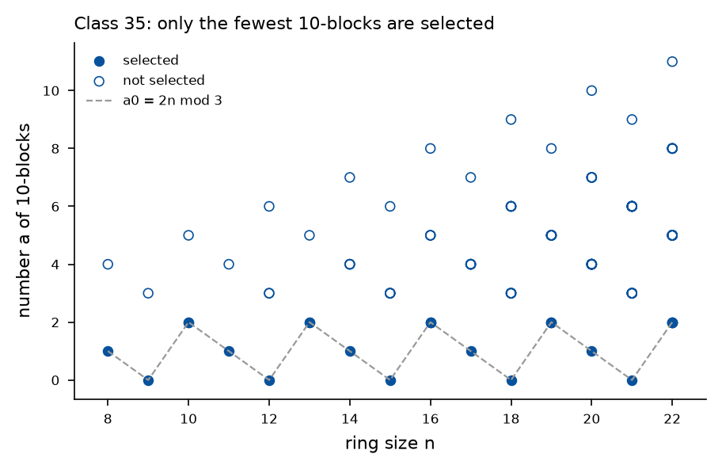
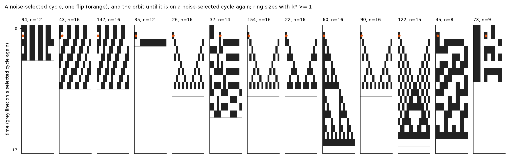

# Why the small-noise classification of elementary cellular automata depends on the ring size

Ring-size study on top of version 0.2 of *Rule identifiability in elementary cellular automata under
dynamical noise* (version DOI 10.5281/zenodo.24093547). Branch `ring-size-mechanisms`. Generated by
`code/ring_size/make_report.py` from `code/ring_size/report_template.md` and the data in
`data/ring_size/`; every number below is filled in from a data file.

Every claim carries one tag:
**[proved]** a proof is given here (computer-assisted proofs say which finite computation they rest on);
**[computed]** an exact computation for the ring sizes stated, nothing beyond them;
**[observed]** a pattern in computed data, or a sampled test, without exactness for the statement as a whole.

## Summary

The ring size enters through one object, the one-flip graph G1 between the cycles of the map: the
noise-selected cycles are exactly a union of its closed classes (Theorem A, proved for all n), and a
cycle that cannot be left with one flip is selected alone as soon as every other cycle reaches it by
one-flip steps, however large the direct entry cost (Lemma B). In the switching classes that cycle is a spatially periodic crystal that exists only
when its period divides n (classes 94, 43, 142, and class 35 within its code-carrying family), or the
zero state, which cannot be left with one flip exactly when a single flip dies out on the ring (classes
154, 26, 22, 60, 90, 122; inherited from rule 90's nilpotency at n = 2^k for 154 and 26, proved). What is
proved for all n: the general statements, k* = 0 for classes 154 and 45 at odd n, the one-flip radius of
the selected cycle (class 94 for all 3 | n; the zero state of 154, 26 for even n and of 22 for 4 | n).
What is not proved for any of these classes: that every cycle reaches the selected crystal or zero state by
one-flip steps; this single statement is computed for n <= 22 and sampled up to n = 32.
Class 122 at even n, class 26 away from powers of two, and the single switches of classes 45 and 73 resist.

## 1. Question

For n = 8..20, v0.2 found 13 of the 88 classes whose small-noise order k* changes side with the ring
size n (k* = 0 iff the noise-selected cycles, those of minimum stochastic potential, jointly contain all
eight neighbourhood codes). The question of this study: why does the classification depend on n, and
which of the observed patterns can be proved for every n? Not in scope: other noise models, unknown
eps, partial observation, changes to v0.2.

## 2. Literature

Full review with access status, what was read (version, pages) and BibTeX: `literature_ring_size.md`
(prepared in this session by a separate literature track; nothing is marked as read that was not read).
Several hosts were refused by the sandbox even after access was approved (Wolfram Atlas, wolframscience.com,
projecteuclid.org, direct arxiv.org, ddlab.org); Martin–Odlyzko–Wolfram (1984), Jen (1986, 1988),
Wuensche–Lesser (1992) and Mairesse–Marcovici (2014) were not read.

**Has the dependence of noise-selected attractors on the ring size been studied?** *Not found* in the
searched sources for ECA with i.i.d. bit-flip noise and minimum-stochastic-potential selection. Closest:

* Bagnoli, Baia and Matteuzzi (arXiv:2406.15408 v2, the extended version of the ACRI 2024 chapter; the
  chapter itself not read) treat all 88 classes under a single-flip "vanishing" noise, but only at L = 17
  (Table 2) and with a single-flip chain between attractors, not stochastic potentials; they do not vary L.
* Ellison (1993, Econometrica 61, Theorem 1(b), p. 1055): coordination on a circle; the parity of N changes
  the order of the non-selected state through a 2-cycle that exists only for even N; the selected state does
  not change with N.
* Bušić, Mairesse and Marcovici (2013, Adv. Appl. Probab. 45, §5.1, p. 977): a majority-flip PCA on Z/nZ
  puts its invariant measure on the two alternating configurations exactly when n is even. Fixed noise, not
  a small-noise limit; the closest published analogue of crystal capture found.
* Studies of asynchronous updating report ring-size conditions (n even, 3 | n, 4 | n) for convergence;
  different noise model, not read.

**Rule 154 under noise:** *not found*, apart from one row of Bagnoli et al.'s Table 2 at L = 17 (1688
attractors, S = S* = 1, no discussion). Powley and Stepney (2009, J. Cellular Automata 4:125–136, §5.2,
read) place 154 as the only nonlinear rule in the group of the linear rules by the even/odd alternation of
the automorphism count of its transition graph, and name the shared Sierpiński pattern from a single seed.
That rule 154 is reversible for odd N is stated by Nobe and Yura (2004, Proposition 1) according to a search
snippet only (not read); Lemma P below proves bijectivity at odd n independently. No conjugacy or factor map
between 154 and rule 90, and no statement on 154 at n = 2^k, was found (in this study, every block map of width at most 4
that intertwines rule 154 with a radius-1 rule maps it onto rule 154 or 166, its own symmetry class;
no factor onto an additive rule exists at these widths [computed, `factor_search.csv`]).

**Rule 90 at n = 2^k** (used in Proposition R154): NKS p. 963 (read) gives the fraction of states on cycles
for rules 60 and 90 as 2^(−2^IntegerExponent[n,2]), which for n = 2^k leaves only the null state; the
nilpotency is also proved directly in v0.2 (Proposition 1) and here.

**Radius and modified coradius.** Ellison (2000, Rev. Econ. Stud. 67:17–45, doi 10.1111/1467-937X.00119),
read in the January 1999 working-paper version (theorem numbers of that version): radius R(Ω), coradius,
modified coradius CR*(Ω) (path cost minus the radii of the intermediate limit sets), and Theorem 2: if
R(Ω) > CR*(Ω) for a union Ω of limit sets, the long-run stochastically stable set is contained in Ω.

## 3. Setting and notation

As in `note/note_v0.2.tex`: rule f, global map F on Z/nZ, resistance r(x, y) = H(Fx, y), cycles
C_1..C_m of F, V(C, C') the minimum path resistance from C to C', stochastic potential gamma(C) the
minimum weight of an in-tree on the cycles rooted at C, S the set of noise-selected cycles
(gamma = gamma_min). V(C, C') >= 1 for C != C' (a zero-resistance step from a cycle state stays on the
cycle). New notation:

* **one-flip graph** G1: the digraph on the cycles with an edge C -> C' iff V(C, C') = 1, i.e. one flip in
  some state of C followed by the deterministic orbit ends on C';
* **radius** r(C) = min over C' != C of V(C, C') (r(C) >= 2 iff no single flip leaves C);
* **closed class**: a strongly connected component of G1 that no edge of G1 leaves;
* **crystal**: a cycle whose states have spatial period p < n; it exists on Z/nZ only if p | n [proved: the spatial period divides n].

All computations use the v0.2 solver (`code/fw/`) for cycles, V and gamma, and
`code/ring_size/mech.py` for G1, radii, periods and the tests below. Before use, an independent
verifier (`code/ring_size/verify_mech.py`: own map, own cycles, Dijkstra on the full resistance graph
without the single-layer reduction, potentials by networkx arborescences) was compared field by field:
432 (rule, n) pairs (all 88 classes at n = 4..8, the 13 switching classes at n = 9, 10),
0 disagreements after one convention fix (BUG-R1, a single cycle was called a crystal
orbit; regression test in `code/ring_size/test_ring_size.py`). The mechanism records for the 13 classes
at n = 8..20 agree with `data/fw_sweep.csv` of v0.2 in the number of cycles, the number of selected
cycles, gamma_min, k_c and k* for all 169 (rule, n) pairs (0 disagreements).

## 4. General results

**Re-rooting.** If T is an in-tree rooted at R and N != R, then T minus the out-edge of N plus the edge
R -> N is an in-tree rooted at N. (Every node still reaches R or N; N has no out-edge, so no cycle can
form.) If the added edge has weight 1, the weight does not increase, because every removed edge weighs
at least 1.

**Lemma 1 (closure) [proved].** If C is noise-selected and V(C, C') = 1, then C' is noise-selected.
*Proof.* Re-root an optimal in-tree at C' along the edge C -> C' of weight 1: the weight does not increase. ∎

**Lemma 2 (selected cycles lie in closed classes) [proved].** Every noise-selected cycle lies in a closed class of G1.
*Proof.* Suppose C is selected and lies in no closed class. In a finite digraph a closed class K is
reachable from every node; take a simple G1-path C = D_0 -> D_1 -> ... -> D_k with D_k in K and D_i not in K
for i < k. Let T_0 be an optimal in-tree rooted at C. Since C is not in K, the nodes of K reach C in T_0,
so T_0 contains an edge e* = (E -> X) with E in K and X not in K; e* has weight at least 2 because no
weight-1 edge leaves a closed class. Re-root along D_1, ..., D_k (weight does not increase; each step removes
only the out-edge of the new root, and E is none of D_1..D_{k-1}). If D_k = E the last step removed e*
(weight >= 2) and added an edge of weight 1. Otherwise continue along a simple G1-path inside K from
D_k to E (K is strongly connected in G1); e* survives until the last step, which removes it. In both
cases the result is an in-tree rooted at E of weight at most gamma(C) - 1 = gamma_min - 1, a
contradiction. ∎

**Theorem A [proved].** The set of noise-selected cycles is a union of closed classes of G1. If G1 has a
unique closed class K, then S = K and gamma_min = m - 1. Hence k* = 0 iff the selected closed classes
jointly contain all eight codes.
*Proof.* By Lemma 2 every selected cycle lies in a closed class, and by Lemma 1 (K is strongly connected
by weight-1 edges) with one member all of K is selected. If K is unique, S is a non-empty union of
closed classes, so S = K; every node reaches K in G1 and K is strongly connected in G1, so a
breadth-first in-tree of weight-1 edges toward any node of K has weight m - 1, the trivial lower bound. ∎

In all 180 non-bijective (rule, n) records of the 13 classes (n = 8..22) the
selected set equals the union of all closed classes of G1 [computed]; G1 has a single closed class in
175 of them.

**Lemma B (step-by-step criterion) [proved].** Let A = {A_1, ..., A_q} be a rotation orbit of cycles with
r(A_i) >= 2, and suppose every cycle reaches A_1 in the graph G2 whose edges are the weight-1 edges out
of cycles not in A and the weight-2 edges out of cycles in A. Then S = A and gamma_min = m + q - 2.
*Proof.* A breadth-first in-tree toward A_1 in G2 has weight (m - q)·1 + (q - 1)·2 = m + q - 2. Every
in-tree rooted outside A has q edges out of A, each of weight >= 2, and m - 1 - q further edges of
weight >= 1: weight >= m + q - 1. gamma is constant on a rotation orbit because F commutes with
rotations. ∎

Lemma B needs only one-flip and two-flip steps; it does not use the direct entry cost
V(C, A) = min_i V(C, A_i), which grows with n for every crystal found here (Section 5.1). It is the
step-by-step argument the brief asked for. *Relation to Ellison (2000).* With Ω = A, the hypotheses of Lemma B give R(Ω) >= 2 (no single flip leaves
the basin of a phase, so none leaves the basin of Ω), and the one-flip paths of G2 give modified cost
(r - 1) - (r - 2) = 1 through r - 2 intermediate cycles of radius 1, i.e. CR*(Ω) <= 1 < R(Ω): this is the
situation of Ellison's Theorem 2 (working-paper numbering), which gives containment of the selected set in Ω.
Lemma B is proved above directly by counting tree edges, without Ellison's convention that paths consist of
distinct states; it adds equality (S = A, by rotation symmetry) and the exact value of gamma_min, which
the data check (column gamma_min = m + q - 2 in 5.1).

**Lemma Z (zero state) [proved].** If F(0) = 0, then r(0) >= 2 iff the orbit of the single flip e_0
returns to 0. *Proof.* The states one flip away from the fixed point 0 are the n rotations of e_0, and
rotation commutes with F and fixes 0. ∎

**Lemma H (local healing) [proved].** Let X be a cycle whose states are p-periodic in space. If, on the
infinite line, every single flip of every state of X is back on X after at most tau steps, then
r(X) >= 2 on every ring Z/nZ with p | n and n >= 2 tau + 1. *Proof.* Cell i at time t depends only on
the initial cells [i - t, i + t]; for t <= (n - 1)/2 this window contains at most one of the flipped
sites j + kn of the n-periodic configuration, so the ring evolution agrees cell by cell with the
single-flip evolution on the line. At t = tau that evolution is a p-periodic state of X, and its
translates by multiples of n (multiples of p) coincide. ∎ The healing check (`lightcone.py`) simulates on
a ring of size at least 2·200 + 1, which equals the line for t <= 200.

**Lemma P (bijectivity for all odd n) [proved].** Closed walks of length n in the pair graph of a rule
(vertices: pairs of 2-letter windows of two configurations x, y; edges: one-letter extensions with
f(x-window) = f(y-window)) are exactly the pairs of ring configurations of size n with Fx = Fy; x != y iff
the walk visits an off-diagonal vertex. A closed walk lies in one strongly connected component and has
length divisible by its period. If every component that contains an off-diagonal vertex has even
period, F is injective, hence bijective, on every ring of odd size. For rules **154 and 45** both
off-diagonal components have period 2 (`data/ring_size/injectivity.csv`; checked against brute-force
bijectivity of all 256 rules for n = 3..13 in the tests) [proved]. By v0.2 a bijective map has k* = 0;
so **k* = 0 for classes 154 and 45 at every odd n [proved]**.

## 5. Mechanisms of the 13 switching classes

The k* map for n = 4..22 with the mechanism found (n = 4..7 from v0.2):

k* by class (rows) and n (columns); n = 4..7 from v0.2, n >= 8 from `mechanisms.csv` (`.` = not computed):

| class | 4 | 5 | 6 | 7 | 8 | 9 | 10 | 11 | 12 | 13 | 14 | 15 | 16 | 17 | 18 | 19 | 20 | 21 | 22 |
|---|---|---|---|---|---|---|---|---|---|---|---|---|---|---|---|---|---|---|---|
| 94 | 1 | 0 | 1 | 0 | 0 | 1 | 0 | 0 | 1 | 0 | 0 | 1 | 0 | 0 | 1 | 0 | 0 | 1 | 0 |
| 43 | 1 | 0 | 0 | 0 | 1 | 0 | 0 | 0 | 1 | 0 | 0 | 0 | 1 | 0 | 0 | 0 | 1 | 0 | 0 |
| 142 | 1 | 0 | 0 | 0 | 1 | 0 | 0 | 0 | 1 | 0 | 0 | 0 | 1 | 0 | 0 | 0 | 1 | 0 | 0 |
| 35 | 0 | 0 | 1 | 0 | 0 | 1 | 0 | 0 | 1 | 0 | 0 | 1 | 0 | 0 | 1 | 0 | 0 | 1 | 0 |
| 26 | 2 | 0 | 1 | 1 | 1 | 1 | 1 | 0 | 1 | 1 | 0 | 1 | 2 | 0 | 1 | 1 | 0 | 1 | 0 |
| 37 | 1 | 1 | 0 | 0 | 1 | 1 | 1 | 0 | 0 | 1 | 1 | 1 | 1 | 0 | 0 | 1 | 1 | 1 | 1 |
| 154 | 1 | 0 | 0 | 0 | 1 | 0 | 0 | 0 | 0 | 0 | 0 | 0 | 1 | 0 | 0 | 0 | 0 | 0 | . |
| 22 | 1 | 1 | 1 | 1 | 1 | 0 | 0 | 0 | 0 | 0 | 1 | 1 | 1 | 0 | 0 | 0 | 0 | 0 | 0 |
| 60 | 1 | 0 | 0 | 0 | 1 | 0 | 0 | 0 | 0 | 0 | 0 | 0 | 1 | 0 | 0 | 0 | 0 | 0 | 0 |
| 90 | 2 | 0 | 0 | 0 | 2 | 0 | 0 | 0 | 0 | 0 | 0 | 0 | 2 | 0 | 0 | 0 | 0 | 0 | 0 |
| 122 | 1 | 1 | 1 | 1 | 0 | 1 | 1 | 1 | 0 | 1 | 1 | 1 | 0 | 1 | 1 | 1 | 0 | 1 | 0 |
| 45 | 1 | 0 | 0 | 0 | 1 | 0 | 0 | 0 | 0 | 0 | 0 | 0 | 0 | 0 | 0 | 0 | 0 | 0 | 0 |
| 73 | 1 | 0 | 1 | 0 | 0 | 1 | 0 | 0 | 0 | 0 | 0 | 0 | 0 | 0 | 0 | 0 | 0 | 0 | 0 |

Summary of mechanisms (details in 5.1-5.5):

| class | pattern (n <= 22) | mechanism | status |
|---|---|---|---|
| 94 | k* >= 1 iff 3 \| n | crystal capture, (011)^{n/3}, 3 phases | radius proved; reachability computed/sampled |
| 43, 142 | k* >= 1 iff 4 \| n | crystal capture, travelling (0011)^{n/4} | radius computed to 400; reachability computed/sampled |
| 35 | k* >= 1 iff 3 \| n | code-101 carriers = {10,100}-words; fewest 10-blocks selected; a0 = 0 at 3 \| n | computed |
| 154 | k* >= 1 iff n = 2^k | zero state; radius from rule-90 nilpotency | odd n proved (k* = 0); radius at even n proved; reachability computed/sampled |
| 60, 90 | k* >= 1 iff n = 2^k | nilpotent at 2^k (v0.2) | proved (v0.2) |
| 22 | k* >= 1 iff seed of 0 returns | zero state | seed set proved for 4 \| n, computed to 256 |
| 26 | 2^k: zero state; else code 7 | zero state; 111-defects in (100) | radius at 2^k proved; rest resists |
| 122 | 2^k - 1: zero state; else code 2 | zero state; checkerboard | checkerboard selection resists |
| 37 | k* = 0 iff n mod 6 in {0, 5} | period-6 defect family | computed |
| 45 | only n = 8 | uniform 2-cycle radius 2 at n = 8; odd n bijective | odd n proved; n = 8 computed |
| 73 | only n = 9 | uniform 2-cycle not selected at n = 9 | computed |

### 5.1 Crystal capture: classes 94, 43, 142 [computed n = 8..22]

At every n with p | n in the computed range, the noise selects exactly the rotation orbit of one
crystal, its codes miss some neighbourhood, Lemma B holds, and the potential is the one Lemma B
gives (column gamma_min = m + q - 2). Class 94: the three phases of the fixed point (011)^{n/3}, codes
3, 5, 6. Classes 43 and 142: one travelling cycle (0011)^{n/4} (temporal period 4, all four phases on
one cycle), codes 1, 3, 4, 6; rules 43 and 142 agree on these four codes and differ exactly on the other
four, so they share the crystal. Every other cycle has radius 1, the crystal has radius 2, and the
direct entry cost grows with n:

| class | n | cycles | q (selected) | radius crystal | max radius others | max direct entry cost | Lemma B holds | gamma_min | m + q - 2 |
|---|---|---|---|---|---|---|---|---|---|
| 43 | 8 | 13 | 1 | 2 | 1 | 2 | True | 12 | 12 |
| 43 | 12 | 61 | 1 | 2 | 1 | 3 | True | 60 | 60 |
| 43 | 16 | 283 | 1 | 2 | 1 | 4 | True | 282 | 282 |
| 43 | 20 | 1529 | 1 | 2 | 1 | 5 | True | 1528 | 1528 |
| 94 | 9 | 31 | 3 | 2 | 1 | 2 | True | 32 | 32 |
| 94 | 12 | 147 | 3 | 2 | 1 | 2 | True | 148 | 148 |
| 94 | 15 | 509 | 3 | 2 | 1 | 3 | True | 510 | 510 |
| 94 | 18 | 1881 | 3 | 2 | 1 | 3 | True | 1882 | 1882 |
| 94 | 21 | 6927 | 3 | 2 | 1 | 4 | True | 6928 | 6928 |
| 142 | 8 | 15 | 1 | 2 | 1 | 2 | True | 14 | 14 |
| 142 | 12 | 61 | 1 | 2 | 1 | 3 | True | 60 | 60 |
| 142 | 16 | 285 | 1 | 2 | 1 | 4 | True | 284 | 284 |
| 142 | 20 | 1531 | 1 | 2 | 1 | 5 | True | 1530 | 1530 |

* **Radius for all n.** Class 94: Lemma H applies with tau = 3, so r(crystal) >= 2 for every
  n divisible by 3 with n >= 7 [proved]; n = 6 is checked directly [computed]
  (`crystal_radius.csv`, which also gives r >= 2 at every 3 | n up to 399 except n = 3). Classes 43 and
  142 do not heal locally: half of the single flips start a domain of another phase of the same
  travelling cycle that grows with both walls moving outward until it fills the ring, so the orbit
  returns to the cycle only through the ring (space-time figure in 5.5). Lemma H does not apply; r >= 2 is computed
  exactly at every n divisible by 4 up to 400 (`crystal_radius.csv`) [computed].
* **Reachability.** Lemma B needs every cycle to reach the crystal by one-flip steps (two flips allowed
  only out of the crystal phases). This is computed for n <= 22 and tested by sampling
  at n = 24..32 (Section 5.6) [observed]; it is not proved for all n. With it, k* >= 1 at p | n
  follows from Lemma B [proved conditional on reachability].
* **The other direction (p does not divide n gives k* = 0).** The crystal cannot exist [proved], and in the
  computed range G1 then has a single closed class that covers all eight codes (Theorem A gives
  k* = 0) [computed]. A proof for all n would need the closed classes of G1 for all n; not found.
* At 3 ∤ n no cycle of class 94 has its codes within {3, 5, 6} [computed n <= 22].

### 5.2 Class 35: a defect family on a period-3 crystal [computed n = 8..22]

Class 35 is not crystal capture: the noise selects almost all cycles. What changes with n is which
cycles carry code 5 (101). In the computed range [computed, `rule35_blocks.csv`]:
every cycle containing 101 is a travelling word over the blocks 10 and 100 (2a + 3b = n, a the number
of 10-blocks, a >= 1); every family member has a = a0 (mod 3), a0 = 2n mod 3; exactly the members with
a = a0 are selected, the members with a = a0 + 3, a0 + 6, ... are not, and all cycles outside the family
are selected. At 3 | n the minimum is a0 = 0, the pure crystal (100)^{n/3}, which contains no 101:
the selected set misses code 5. At 3 ∤ n, a0 is 1 or 2 and the selected family members contain 101.
So class 35 is crystal capture of the code-carrier family, not of the whole selected set.

| n | a0 | selected_a | not_selected_a | code5_missing |
|---|---|---|---|---|
| 8 | 1 | 1 | 4 | 0 |
| 9 | 0 | 0 | 3 | 1 |
| 10 | 2 | 2 | 5 | 0 |
| 11 | 1 | 1 | 4 | 0 |
| 12 | 0 | 0 | 3,6 | 1 |
| 13 | 2 | 2 | 5 | 0 |
| 14 | 1 | 1 | 4,7 | 0 |
| 15 | 0 | 0 | 3,6 | 1 |
| 16 | 2 | 2 | 5,8 | 0 |
| 17 | 1 | 1 | 4,7 | 0 |
| 18 | 0 | 0 | 3,6,9 | 1 |
| 19 | 2 | 2 | 5,8 | 0 |
| 20 | 1 | 1 | 4,7,10 | 0 |
| 21 | 0 | 0 | 3,6,9 | 1 |
| 22 | 2 | 2 | 5,8,11 | 0 |

Not proved for any n beyond the computed range.

### 5.3 The zero state: classes 154, 26, 22, 60, 90, and 122 at n = 2^k - 1

For rules with F(0) = 0, Lemma Z reduces "0 cannot be left by one flip" to the single-seed orbit.
Wherever in n = 8..22 the zero state is selected alone, Lemma B holds with A = {0}
[computed]; over the 59 (rule, n) pairs of classes 22, 26, 122, 154 in that range,
"the single-flip orbit returns to 0" coincides with "0 is selected alone" [computed, `zero_mechanism.csv`].
Single-seed orbits for n = 4..256 (`seed_orbits.csv`; orbits not closed after 400000 steps are
reported as undetermined):

| rule | returns_to_0_at_n | undetermined_n |
|---|---|---|
| 22 | 4, 5, 6, 7, 8, 14, 15, 16, 30, 31, 32, 61, 62, 63, 64, 121, 125, 126, 127, 128, 253, 254, 255, 256 | 31 |
| 26 | 4, 8, 16, 32, 64, 128, 256 | 33 |
| 122 | 7, 15, 31, 63, 127, 255 | 33 |
| 154 | 4, 8, 16, 32, 64, 128, 256 | 33 |

**Proposition R154 [proved].** Rules 154 and 26 agree with rule 90 on the codes 0, 1, 2, 4, 5, i.e. on every
configuration without two adjacent ones (154 differs from 90 on codes 6 and 7, 26 on code 6). On an
even ring the rule-90 orbit of e_0 lies at time t on the sites of parity t (since (F_90 x)_i = x_{i-1} +
x_{i+1}), so it never has two adjacent ones and the orbits of e_0 under rules 154, 26 and 90 coincide.
In GF(2)[X]/(X^n - 1) the rule-90 orbit is X^{-t}(1 + X)^{2t}, which vanishes iff X^n - 1 divides a power of
1 + X, i.e. iff n is a power of two (write n = 2^a m, m odd: X^n - 1 = (X^m - 1)^{2^a}, and X^m - 1 has a
factor other than 1 + X iff m > 1). By Lemma Z, **for even n, r(0) >= 2 under rules 154 and 26 iff n is a
power of two**. For odd n, rule 154 is bijective (Lemma P), so k* = 0.

**Proposition R22 [proved].** Let R_t be the rule-90 orbit of e_0. On every ring with 4 | n, the rule-22
orbit of e_0 is R_t at even t and R_t ∪ R_{t-1} at odd t; hence **for 4 | n, r(0) >= 2 under rule 22 iff n is
a power of two**. *Proof.* Rule 22 is "exactly one of the three cells is 1", f = a + b + c + abc over GF(2).
Even t -> t + 1: R_t lies on one parity class, so its ones are isolated; at sites of parity t + 1
exactly-one equals XOR of the two neighbours (R_{t+1}), at sites of parity t the cell keeps its value
(R_t). Odd t -> t + 1: at a site i of parity t (both neighbours in R_{t-1}, the cell in R_t =
R_{t-1}(i-1) + R_{t-1}(i+1)) the triple is 000, 110, 011 or 101, all mapped to 0; at a site i of parity
t + 1, a + b + c = R_{t+1}(i) + R_{t-1}(i) with b = R_{t-1}(i), so the value is R_{t+1}(i) iff abc = b, i.e.
iff R_{t-1}(i) = 1 forces R_t(i-1) = R_t(i+1) = 1, i.e. R_{t-1}(i±2) = 0. For even s, R_s on Z/nZ is R_{s/2}
on the sublattice ring Z/(n/2)Z dilated by 2; with n/2 even, R_{s/2} lies on one parity class, so R_s
has no two ones at distance 2. At even t the orbit is R_t, which is 0 iff the rule-90 orbit has died. ∎
For n ≡ 2 (mod 4) and odd n the seed orbit of rule 22 returns at 5, 6, 7, 14, 15, 30, 31, 61, 62, 63, 121, 125, 126, 127, 253, 254, 255 in n <= 256
[computed]; there is no proof, and the set is not {2^k - 2, 2^k - 1, 2^k} alone (121, 125, 253).

**Why rule 154 selects only 0 at n = 2^k although the map has many cycles.** By Theorem A the potential
counts nothing but the cycles that cannot be left with one flip: at n = 8 and 16 the zero state is the
only one (31 and 4081 cycles; every other cycle has radius 1), every cycle reaches 0 in G1
(maximum distance 4 and 8; the distance follows the mean number of ones on the cycle,
Spearman 0.94 and 0.96, `g1_distance_154.csv`), and gamma_min = m - 1 [computed]. The
number of cycles is irrelevant to the selection; what decides it is that rule 90's nilpotency at 2^k
makes a single flip of 0 die (Proposition R154), while at other even n it lands on a rule-90 cycle
on one parity sublattice, so 0 has radius 1 and is no longer a closed class on its own. At even n not a power of two all
cycles form one strongly connected G1 and are all selected [computed for even n <= 20]. What is not proved
is the reachability of 0 from every cycle at all n = 2^k; it was tested at n = 32 (Section 5.6) [observed].
Prediction beyond 20: k* >= 1 at n = 32 follows from Proposition R154 and Lemma B if every cycle reaches 0;
k* itself is not computed there.

Class 26 at n = 2^k is the same mechanism (zero state alone; k* = 2 at n = 16). Class 122 at
n = 2^k - 1 is the same mechanism with a different seed set: its seed orbit returns exactly at
n = 7, 15, 31, 63, 127, 255 in n <= 256 [computed]; the n where its orbit did not close coincide with the
undetermined n of rules 26 and 154 shifted by one [observed].

### 5.4 Class 122 at other n: the checkerboard [computed n = 8..22]

The only cycle carrying code 2 (010) is the checkerboard 2-cycle (10)^{n/2}, so code 2 is missing at
every odd n except where the zero mechanism already decides. The checkerboard is selected at
n = 8, 12, 14, 16, 20, 22 and not selected at n = 10, 18 (`code_carriers.csv`). The sealed "k* = 0 iff 4 | n"
fails at n = 22 (and n = 14 has the checkerboard and the zero state selected with codes 0, 2, 5 only).
Why the checkerboard is selected at n = 14 and 22 but not at 10 and 18 is not explained: **resists**.

### 5.5 Classes 22, 26, 37, 45, 73 (what changes at each switch)

* **22.** Every switch in n = 4..22 is the zero mechanism: k* = 1 exactly where the single-flip orbit
  of 0 returns to 0 (n = 4..8, 14, 15, 16), and then 0 is selected alone [computed]. The seed set is
  proved for 4 | n (Proposition R22) and computed up to 256 for the other n; v0.2 reported no
  pattern.
* **26.** At n = 2^k: zero mechanism (proved radius, Proposition R154). Otherwise the missing code is 7
  (111). Its carriers are (100)-crystals with 111-defects; for n = 9..21 a selected carrier exists iff
  n ≡ 2 (mod 3) (one defect fits), but at n = 22 a carrier of another type is selected and k* = 0
  [computed]: the mod-3 description found after sealing fails, **resists**.
* **37.** Codes 2 and 5 are missing except at n = 11, 12, 17, 18 (sealed fit: k* = 0 iff n mod 6 in {0, 5},
  holds for n = 8..22) [computed]. There the selected set gains carriers built on the period-6 pattern
  100000 (n ≡ 0) or a single defect in it (n ≡ 5) with temporal periods 6 to 3n. Explained only as a
  period-6 defect family; not proved.
* **45.** Odd n: bijective, k* = 0 [proved, Lemma P]. n = 8: the uniform 2-cycle 0 <-> 1 is selected alone
  with radius 2 (codes 0 and 7); at every even n >= 10 in the computed range it has radius 1 and all
  cycles are selected [computed]. Why only n = 8: not explained.
* **73.** The only switch for n >= 8 is n = 9: the uniform 2-cycle (code 7) is not selected there and
  period-3 cycles are; at all other n it is selected [computed]. Not explained.

### 5.6 Beyond the enumerated sizes (no enumeration of 2^n states)

`code/ring_size/sample_reach.py`: cycles reached from random initial states (seed 1), exact one-flip
successors (every cell of every state of the cycle), best-first search for a one-flip path into the
target. A found path is an exact certificate for that cycle; unsampled cycles are not covered, and
random initial states favour large basins. [observed]

| rule | n | target | target_radius_ge2 | sampled | distinct_cycles | reach_target | max_path_len |
|---|---|---|---|---|---|---|---|
| 22 | 30 | zero | 1 | 200 | 7 | 200 | 1 |
| 22 | 31 | zero | 1 | 200 | 5 | 200 | 1 |
| 22 | 32 | zero | 1 | 200 | 10 | 200 | 1 |
| 26 | 32 | zero | 1 | 200 | 200 | 200 | 5 |
| 43 | 24 | crystal:0011 | 1 | 200 | 91 | 200 | 3 |
| 43 | 28 | crystal:0011 | 1 | 200 | 107 | 200 | 4 |
| 43 | 32 | crystal:0011 | 1 | 200 | 112 | 200 | 4 |
| 94 | 24 | crystal:011 | 1 | 200 | 125 | 200 | 5 |
| 94 | 27 | crystal:011 | 1 | 200 | 151 | 200 | 6 |
| 94 | 30 | crystal:011 | 1 | 200 | 179 | 200 | 9 |
| 122 | 31 | zero | 1 | 200 | 34 | 200 | 1 |
| 142 | 24 | crystal:0011 | 1 | 200 | 91 | 200 | 3 |
| 142 | 28 | crystal:0011 | 1 | 200 | 104 | 200 | 4 |
| 142 | 32 | crystal:0011 | 1 | 200 | 118 | 200 | 4 |
| 154 | 24 | zero | 0 | 200 | 200 | 200 | 8 |
| 154 | 28 | zero | 0 | 200 | 200 | 200 | 9 |
| 154 | 32 | zero | 1 | 200 | 200 | 200 | 9 |

## 6. Predictions (sealed in `PREDICTIONS_ring_size.md` before any new computation)

Outcomes decided from the data files by `code/ring_size/check_predictions.py`
(`data/ring_size/predictions_outcome.csv`): holds: 41; fails: 5; not tested: 2; holds (trivially): 1; holds (observed, sampled): 1.

| id | part | outcome | evidence |
|---|---|---|---|
| P1 | 3\|n: selected set = the 3 shifts of (011)^{n/3} | holds | mechanisms.csv, cycle_orbits.csv.gz, n = 8..22 |
| P1 | 3\|n: radius of the crystal 2, every other cycle radius 1 | holds | mechanisms.csv |
| P1 | 3\|n: one-flip graph has a single closed class, the crystal orbit | fails | mechanisms.csv: g1_closed = [3] (one closed class per phase) |
| P1 | 3 does not divide n: no cycle avoids all of codes 0,1,2,4,7 | holds | cycle_orbits.csv.gz: 0 counterexample orbits |
| P2 | class 43, 4\|n: selected = one travelling cycle (0011)^{n/4}, T = 4, radius 2, others radius 1, single closed class | holds | mechanisms.csv |
| P2 | class 142, 4\|n: selected = one travelling cycle (0011)^{n/4}, T = 4, radius 2, others radius 1, single closed class | holds | mechanisms.csv |
| P2 | 4 does not divide n: no cycle with spatial period 4 | holds (trivially) | trivial: the spatial period divides n |
| P3 | 3\|n: cycles containing code 5 = cycles not selected | holds | cycle_orbits.csv.gz |
| P3 | they have spatial period 3 or consist of 3-periodic segments | fails | rule35_blocks.csv: they are travelling words over the blocks 10 and 100 (spatial period n mostly) |
| P4 | 4\|n: a selected cycle with spatial period 4 carries code 2 | fails | cycle_orbits.csv.gz: the only carrier of code 2 is the checkerboard (spatial period 2) |
| P4 | missing code is 2 at n in {9,10,11,13,17,18,19} | holds | mechanisms.csv |
| P4 | n = 15: zero state alone with radius >= 2 | holds | mechanisms.csv |
| P4 | n = 14: uniform states selected with radius >= 2 | fails | mechanisms.csv: selected = zero state and checkerboard, radius 1 |
| P5 | 154, even n not a power of 2: every cycle radius 1, one-flip graph strongly connected | holds | mechanisms.csv, n = [10, 12, 14, 18, 20] |
| P5 | 154, n = 8, 16: zero radius 2, others radius 1, {0} the single closed class | holds | mechanisms.csv |
| P6 | 22: k* = 1 exactly where the single-flip orbit of 0 returns to 0 | holds | zero_mechanism.csv, n = 8..22 |
| P6 | 26, n = 16: zero state alone, k* = 2 | holds | mechanisms.csv |
| P6 | 26, other n with k* >= 1: missing code 7 | holds | mechanisms.csv |
| P7 | 45, n = 8: uniform 2-cycle selected alone | holds | mechanisms.csv |
| P7 | 45, odd n: bijective | holds | injectivity.csv (proved) |
| P7 | 45, even n >= 10: the uniform 2-cycle has radius 1 | holds | cycle_orbits.csv.gz, 7 n |
| P8 | 37: k* = 0 iff n mod 6 in {0, 5} | holds | mechanisms.csv, n = 8..22 |
| P8 | 73: the only switch for n >= 8 is n = 9 | holds | mechanisms.csv, n = 8..22 |
| k*(21,22) | class 35, n = 21: k* = 1 | holds | mechanisms.csv (computed 1) |
| k*(21,22) | class 35, n = 22: k* = 0 | holds | mechanisms.csv (computed 0) |
| k*(21,22) | class 94, n = 21: k* = 1 | holds | mechanisms.csv (computed 1) |
| k*(21,22) | class 94, n = 22: k* = 0 | holds | mechanisms.csv (computed 0) |
| k*(21,22) | class 43, n = 21: k* = 0 | holds | mechanisms.csv (computed 0) |
| k*(21,22) | class 43, n = 22: k* = 0 | holds | mechanisms.csv (computed 0) |
| k*(21,22) | class 142, n = 21: k* = 0 | holds | mechanisms.csv (computed 0) |
| k*(21,22) | class 142, n = 22: k* = 0 | holds | mechanisms.csv (computed 0) |
| k*(21,22) | class 122, n = 21: k* = 1 | holds | mechanisms.csv (computed 1) |
| k*(21,22) | class 122, n = 22: k* = 1 | fails | mechanisms.csv (computed 0) |
| k*(21,22) | class 60, n = 21: k* = 0 | holds | mechanisms.csv (computed 0) |
| k*(21,22) | class 60, n = 22: k* = 0 | holds | mechanisms.csv (computed 0) |
| k*(21,22) | class 90, n = 21: k* = 0 | holds | mechanisms.csv (computed 0) |
| k*(21,22) | class 90, n = 22: k* = 0 | holds | mechanisms.csv (computed 0) |
| k*(21,22) | class 154, n = 21: k* = 0 | holds | mechanisms.csv (computed 0) |
| k*(21,22) | class 154, n = 22: k* = 0 | not tested | not computed: run stopped above the stated cost cap (stopped_runs.csv) |
| k*(21,22) | class 45, n = 21: k* = 0 | holds | mechanisms.csv (computed 0) |
| k*(21,22) | class 45, n = 22: k* = 0 | holds | mechanisms.csv (computed 0) |
| k*(21,22) | class 73, n = 21: k* = 0 | holds | mechanisms.csv (computed 0) |
| k*(21,22) | class 73, n = 22: k* = 0 | holds | mechanisms.csv (computed 0) |
| k*(21,22) | class 37, n = 21: k* = 1 | holds | mechanisms.csv (computed 1) |
| k*(21,22) | class 37, n = 22: k* = 1 | holds | mechanisms.csv (computed 1) |
| k*(21,22) | class 22, n = 21: k* = 1 iff seed returns | holds | mechanisms.csv, seed_orbits.csv |
| k*(21,22) | class 22, n = 22: k* = 1 iff seed returns | holds | mechanisms.csv, seed_orbits.csv |
| P9 | 154, n = 32: zero radius >= 2 | holds | sampled_reach/rule154_n32.csv; proved (Proposition R154) |
| P9 | 154, n = 32: sampled cycles reach 0 by one-flip steps | holds (observed, sampled) | sampled_reach/rule154_n32.csv: 200/200 (observed) |
| P9 | 154: k* = 1 at n = 32, k* = 0 at n = 24, 28 | not tested | not computed (no method that decides k* without enumeration) |

## 7. Verdict

**(a) Proved for all n.**
* General: Theorem A (the noise-selected set is a union of closed classes of the one-flip graph; with a
  unique closed class it is that class), Lemma B (step-by-step criterion; it handles the growing entry
  cost), Lemmas Z, H, P.
* Classes 60 and 90: k* >= 1 iff n is a power of two (v0.2, Proposition 1).
* Classes 154 and 45: k* = 0 at every odd n (Lemma P).
* Class 154 (and 26), even n: the zero state cannot be left by one flip iff n is a power of two
  (Proposition R154). Class 22, 4 | n: the same (Proposition R22).
* Class 94: the crystal (011)^{n/3} cannot be left by one flip for every n divisible by 3, n >= 6 (Lemma H,
  plus n = 6 computed).
* No full divisibility pattern of the classes 94, 43, 142, 35, 122, 154 is proved for all n. Each of the
  crystal and zero-state patterns is proved *conditional on one reachability statement*: every cycle
  reaches the crystal (or 0) by one-flip steps (Lemma B).

**(b) Explained, not proved.**
* Classes 94, 43, 142 (crystal capture): reachability computed for n <= 22, sampled at n = 24..32;
  radius proved (94) or computed up to 400 (43, 142); "p ∤ n gives k* = 0" computed only.
* Class 154 at n = 2^k (zero state, inherited from rule 90): radius proved, reachability computed for
  n = 8, 16 and sampled at n = 32. At even n not a power of two: k* = 0 computed for even n <= 20.
* Class 22 (zero state): its switches are explained by the seed set, which is proved for 4 | n and
  computed up to 256 otherwise; v0.2 had no pattern.
* Class 26 at n = 2^k and class 122 at n = 2^k - 1 (zero state).
* Class 35 (defect family on (100)): the block law of 5.2, computed for n <= 22.
* Class 37 (period-6 defect family; the sealed mod-6 fit holds for n <= 22).

**(c) Resists.**
* Reachability for all n: it requires the closed classes of the one-flip graph for every n, i.e. a
  description of all cycles, which was not found for any of these rules.
* Class 122 at even n (checkerboard selected at 8, 12, 14, 16, 20, 22, not at 10, 18).
* Class 26 at n not a power of two (the mod-3 defect description fails at n = 22).
* The single switches of classes 45 (n = 8) and 73 (n = 9).
* Rule 22's seed set for n ≢ 0 (mod 4) (it contains 121, 125, 253 besides 2^k - 2, 2^k - 1).

## 8. What is and is not established

Established exactly: the mechanism data for the 13 classes at n = 8..22 (154: n <= 21), checked against
v0.2 and an independent verifier; the general statements of Section 4; the propositions in 5.3; the
crystal radius for p | n up to 400; single-seed orbits up to n = 256 where they close. Not
established: any k* value for n > 22; reachability of the crystal or zero state from every cycle
beyond the enumerated sizes (sampled cycles only); the direction p ∤ n gives k* = 0 for any class except
the odd-n statements of Lemma P; mechanisms for the residual switches listed under (c).

Atlas (step 6) [computed]: `data/ring_size/atlas/mechanisms_atlas.csv` holds 1327 (class, n) records (88 classes: the 75 non-switching classes at n = 4..20 and the 13 switching classes at n = 4..7) with the selected-cycle count, the spatial and temporal periods of the selected cycles, the codes they cover, k_c and k*; the selected orbits are in `cycle_orbits_atlas.csv.gz`. The 13 switching classes at n >= 8 are in `mechanisms.csv`; together these cover all 88 classes at n = 4..20. All 1327 atlas records agree with v0.2 in cycles, selected count, gamma_min, k_c and k* (0 disagreements, `atlas/log_atlas.txt`). Space-time pictures of selected cycles for the 13 switching classes: the figure in 5.5.

## 9. Data, code, cost

| file | content |
|---|---|
| data/ring_size/mechanisms.csv | one row per (class, n): cycles, selected, G1 closed classes, radii, crystal test |
| data/ring_size/cycle_orbits.csv.gz | one row per rotation orbit of cycles: pattern, periods, drift, codes, gamma, radius, selected |
| data/ring_size/mech_cost.csv | wall time and peak memory per job |
| data/ring_size/verify_mech_*.csv | independent verifier |
| data/ring_size/seed_orbits.csv | single-flip orbit of the zero state, n = 4..256 |
| data/ring_size/crystal_radius.csv | every single flip of the crystals, p \| n up to 400 |
| data/ring_size/lightcone.csv | healing times on the line (Lemma H) |
| data/ring_size/injectivity.csv | pair-graph certificates (Lemma P) |
| data/ring_size/rule35_blocks.csv, code_carriers.csv, g1_distance_154.csv, zero_mechanism.csv | derived tables (analyze_mechanisms.py) |
| data/ring_size/sampled_reach/ | sampled reachability beyond n = 22 |
| data/ring_size/factor_search.csv | block maps of width <= 4 intertwining rule 154 with a radius-1 rule |
| data/ring_size/stopped_runs.csv | runs stopped above the stated cost cap |
| data/ring_size/predictions_outcome.csv | outcome of every sealed prediction |
| data/ring_size/MANIFEST.sha256 | SHA-256 of every file in data/ring_size |
| code/ring_size/ | mech, verify_mech, run_mech, run_local, ringlang, lightcone, sample_reach, analyze_mechanisms, check_predictions, figures_ring_size, make_report, tests |
| data/ring_size/atlas/ | atlas: 75 non-switching classes at n = 4..20 and the 13 switching classes at n = 4..7; selected cycles (count, spatial and temporal periods, codes); checkpoint as mech_atlas.jsonl.gz |

Cost (2 worker processes at most, one batch at a time): Class 154 at n = 22 was stopped after 7.4 h, above the stated cap of 5 h; it is not computed (`stopped_runs.csv`). Mechanism jobs 194, total CPU 1.9 h, longest job 25 min (class 35, n = 22), peak memory 2.0 GB (`mech_cost.csv`).
